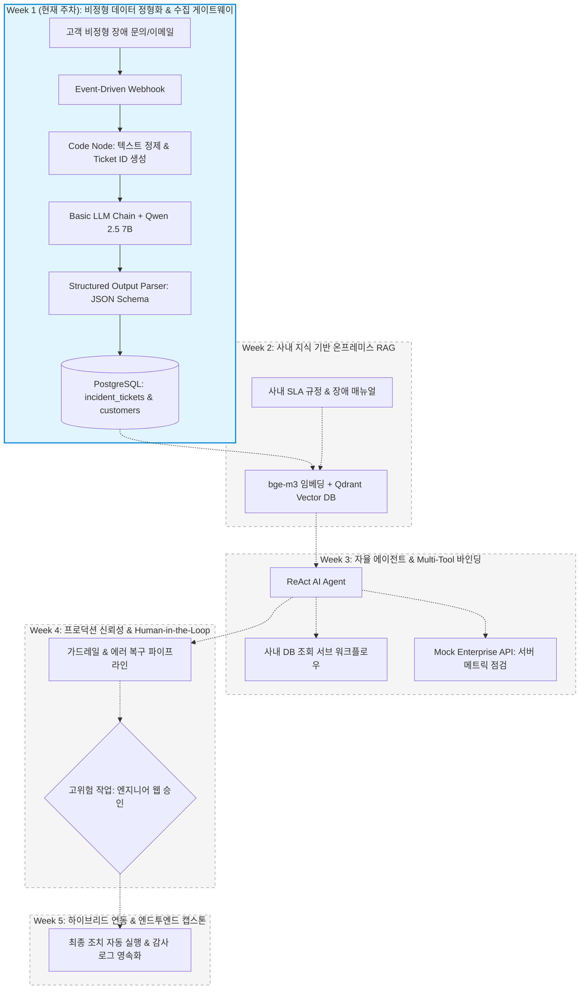
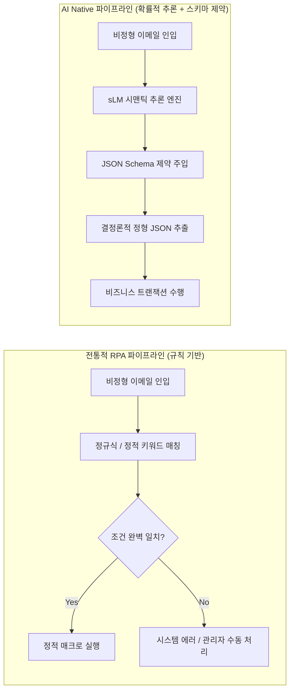
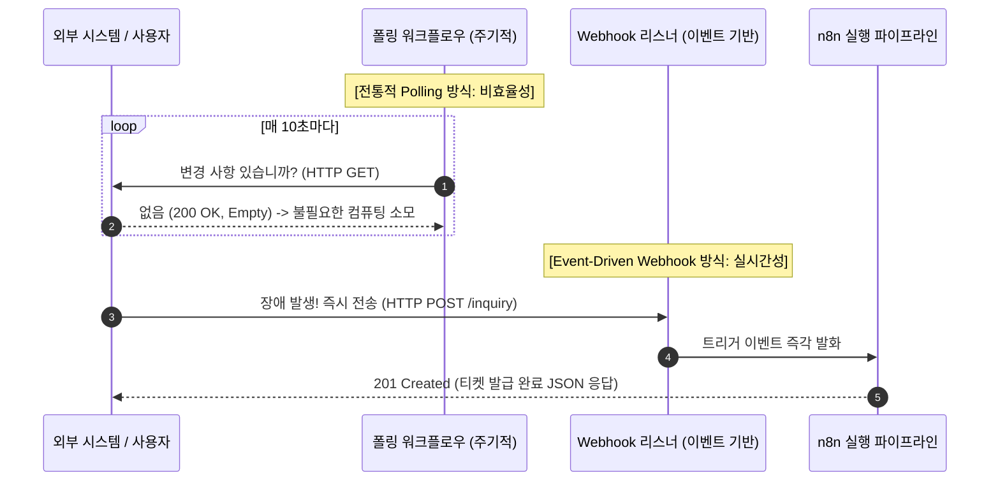
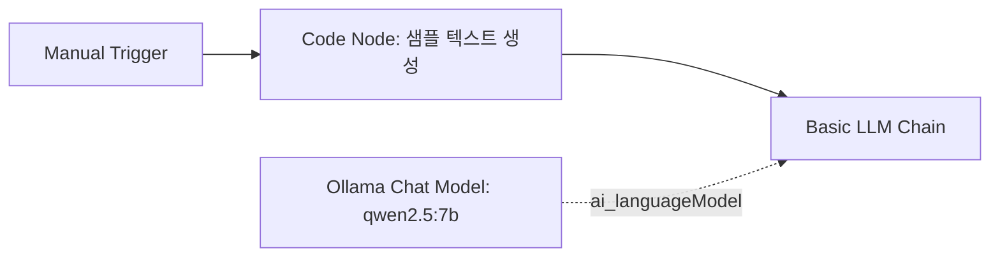
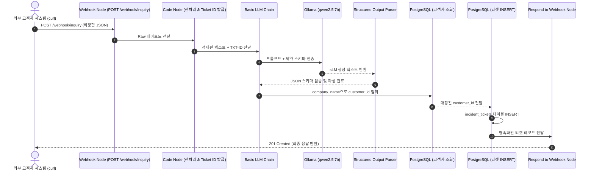

# [Week 01] AI Native 패러다임과 온프레미스 오케스트레이션 인프라 구축

> 🏠 [과정 메인 포털](../README.md) ｜ 📥 [Week 01 완성본 워크플로우 JSON](../03_workflows/week01_structured_extraction.json) ｜ **Week 01** ｜ [다음: Week 02 온프레미스 RAG ⏭️](./Week02_OnPremise_RAG_Vector_Pipeline.md)

---

## 1. 학습 개요 및 전체 아키텍처 내 위치 (Where We Are)

### 1.1 전체 5주 캡스톤 아키텍처 로드맵
현대 엔터프라이즈 환경에서 인공지능(AI)은 단순한 챗봇이나 개별 기능의 보조 도구를 넘어, 기업의 핵심 비즈니스 프로세스를 능동적으로 주도하는 **AI Native 오케스트레이션(AI-Native Orchestration)** 시스템으로 진화하고 있습니다. 본 교육과정은 외부 클라우드로의 데이터 유출이 엄격히 금지된 엔터프라이즈 폐쇄망(Air-gapped Network) 환경을 전제로, 오픈소스 및 자체 호스팅(Self-hosted) 기술 스택만을 활용하여 프로덕션급 **지능형 IT 서비스 관리(ITSM) 및 비즈니스 운영 자동화 플랫폼**을 밑바닥부터 직접 구축하는 5주 완성 실습 과정입니다.



### 1.2 Week 1 모듈의 핵심 미션
Week 1에서 다루는 범위는 전체 지능형 플랫폼의 첫 번째 관문인 **"비정형 인입 데이터의 결정론적 정형화 및 데이터베이스 영속화 파이프라인"**입니다.
다양한 채널(이메일, 웹 폼, 사내 메신저)을 통해 유입되는 고객의 장애 접수 텍스트는 표준화되지 않은 자연어로 구성되어 있어, 전통적인 규칙 기반 시스템으로는 처리하기 어렵습니다. 수강생은 이번 주차를 통해:
1. 로컬 환경에서 컨테이너 기반의 온프레미스 AI 인프라(n8n, Ollama, PostgreSQL)를 가동하고,
2. 경량 거대언어모델(sLM)의 확률적 추론 능력을 JSON Schema로 강력히 통제하여,
3. 비정형 한국어 텍스트로부터 신뢰할 수 있는 정형 데이터를 추출하여 관계형 데이터베이스(RDBMS)에 안전하게 적재하는 End-to-End 파이프라인을 완성합니다.

### 1.3 핵심 학습 목표 (Learning Objectives)
- **아키텍처 관점**: 전통적인 규칙 기반 RPA와 AI Native 아키텍처의 차이점을 설명할 수 있으며, 엔터프라이즈 환경에서 n8n의 *Sustainable Use License(공정 코드 라이선스)*가 지니는 법률적·기술적 의의를 이해한다.
- **AI 엔지니어링 관점**: sLM(Small Language Model)의 추론 메커니즘과 포스트 트레이닝 양자화(FP16 vs INT8 vs Q4_K_M GGUF)의 원리를 수학적으로 이해하고, 하드웨어 스펙에 따른 VRAM 요구량을 정량적으로 산출할 수 있다.
- **핸즈온 구현 관점**: n8n 웹 인터페이스와 Docker 브릿지 네트워크 환경에서 `Webhook` -> `Code Node` -> `Basic LLM Chain(Ollama)` -> `Structured Output Parser` -> `PostgreSQL`로 이어지는 파이프라인을 직접 구성하고 `curl`을 통해 정상 작동을 검증할 수 있다.

### 1.4 선수 지식 및 실습 환경 요구사항
- **선수 지식**: Docker 기초 개념(컨테이너, 이미지, 볼륨, 네트워크), 관계형 데이터베이스 기초 SQL(`SELECT`, `INSERT`), HTTP RESTful 통신 개념.
- **하드웨어 최소 권장 사양**:
  - CPU: 4코어 이상 (x86_64 또는 Apple Silicon)
  - RAM: 16GB 이상 (8GB 환경에서는 양자화 모델 사용 필수)
  - 저장공간: 여유 공간 20GB 이상 (Docker 이미지 및 LLM 가중치 파일 저장용)

---

## 2. 전공 CS & AI 엔지니어링 핵심 이론 (Deep Dive)

### 2.1 전통적 RPA vs AI Native 아키텍처의 패러다임 시프트

#### (1) 전통적 RPA(Robotic Process Automation)의 구조적 한계: 취약한 결정론(Brittle Determinism)
전통적인 RPA 시스템(UiPath, Automation Anywhere 등)은 **유한 상태 기계(Finite State Machine, FSM)**와 **정적 조건문(`if-else`)**을 기반으로 설계됩니다. 시스템은 사전 정의된 규칙, 정확한 화면 UI 좌표(DOM Selector, OCR 좌표), 혹은 고정된 CSV/XML 스키마에 극도로 의존합니다.



이러한 규칙 기반 시스템은 다음과 같은 치명적인 한계점을 지닙니다:
1. **취약성(Brittleness)**: 사용자의 문장 표현이 바뀌거나, 입력 폼의 레이아웃이 1픽셀만 달라져도 정규식(Regex)과 매크로가 붕괴됩니다.
2. **높은 유지보수 TCO(Total Cost of Ownership)**: 비즈니스 예외 케이스가 발생할 때마다 엔지니어가 수작업으로 새로운 `if` 분기 코드를 추가해야 하므로 코드 복잡도가 지수적으로 증가합니다.
3. **의미론적 이해(Semantic Comprehension)의 부재**: "로그인이 전혀 안 됩니다"와 "SSO 인증 토큰 만료 에러 504가 발생합니다"가 본질적으로 동일한 'AUTHENTICATION' 장애임을 스스로 인지하지 못합니다.

#### (2) AI Native 아키텍처: 확률론적 추론의 결정론적 제어
AI Native 아키텍처는 **자연어 처리의 비결정성(Non-deterministic Reasoning)**을 핵심 엔진으로 사용하되, 이를 **엄격한 스키마 제약(Deterministic JSON Schema Boundary)** 안에 가두어 비즈니스 프로세스를 안전하게 수행하도록 설계됩니다.

| 비교 항목 | 전통적 RPA (Legacy Rule-based) | AI Native 워크플로우 (Modern Orchestration) |
| :--- | :--- | :--- |
| **핵심 제어 메커니즘** | 정적 규칙(`If-Else`), 정규표현식, UI 좌표 | 언어모델(sLM)의 시맨틱 추론 + 도구 호출(Tool Calling) |
| **처리 대상 데이터** | 엄격히 정형화된 데이터 (Excel, 고정 템플릿) | 비정형 자연어, 복합 서식, 파편화된 기술 로그 |
| **신규 예외 대응력** | 코드 수정 배포 전까지 100% 프로세스 실패 | Zero-shot / Few-shot 추론을 통한 유연한 적응 |
| **시스템 통합 방식** | 화면 스크래핑(GUI Macro), 단방향 API 매핑 | Event-Driven Webhook, 양방향 지능형 에이전트 오케스트레이션 |
| **유지보수 비용 곡선** | 비즈니스 로직 확장 시 복잡도 지수적 증가 ($O(2^N)$) | 단일 범용 프롬프트 및 스키마 기반 유지보수 용이 |

---

### 2.2 엔터프라이즈 폐쇄망 규제와 n8n Sustainable Use License

#### (1) 망분리(Air-gapped) 규제 환경의 필연성
금융권(전자금융감독규정 제15조), 공공기관(국가정보보안기본지침), 반도체/바이오 제조 대기업에서는 고객의 민감정보(PII), 영업비밀, 사내 소스코드의 유출을 원천 방지하기 위해 외부 인터넷과 물리적·논리적으로 차단된 **망분리 환경(Air-gapped Network)**을 의무화하고 있습니다.
따라서 OpenAI, Anthropic 등 외부 클라우드 SaaS 형태의 LLM API를 호출하는 것은 심각한 컴플라이언스 위반에 해당합니다. 온프레미스 내에서 모든 파이프라인(오케스트레이션 엔진, 추론 서버, 데이터베이스)이 자체 구동되어야 하는 이유가 바로 여기에 있습니다.

#### (2) n8n Sustainable Use License (Fair-code) 분석
오케스트레이션 엔진으로 선정한 `n8n`은 완전한 오픈소스(MIT, Apache 2.0)와는 다른 독자적인 **Sustainable Use License**를 채택하고 있습니다. 학부 및 대학원생이 엔터프라이즈 환경에서 기술을 채택할 때 반드시 검토해야 하는 라이선스 핵심 사항은 다음과 같습니다:

1. **내부 업무 자동화(Internal Business Use)의 완전 무료 사용**:
   - 기업이 사내 인프라에 n8n을 직접 설치하여 사내 ERP 연동, ITSM 티켓 발급, 내부 업무 자동화 용도로 사용하는 것은 라이선스 비용 없이 영구적으로 완전 무료(Free of Charge)입니다.
   - 소스코드에 대한 열람, 사내 목적의 커스텀 노드 개발 및 수정이 전면 허용됩니다.
2. **상업적 재배포 및 호스팅 서비스(Commercial Hosting)의 제한**:
   - n8n의 핵심 가치를 기반으로 제3자에게 유임 SaaS(경쟁 플랫폼)를 제공하거나, n8n 자체를 리브랜딩하여 솔루션 형태로 재판매(OEM)하는 행위는 금지되며 별도의 상용 엔터프라이즈 라이선스 계약이 필요합니다.
3. **본 교육과정의 적합성**:
   - 본 실습은 사내 내부 인프라에서 ITSM 관제 시스템을 자력 구축하는 시나리오이므로, Sustainable Use License의 허용 범위 내에서 100% 합법적이고 안전하게 프로덕션 레벨까지 확장할 수 있습니다.

---

### 2.3 온프레미스 sLM 추론 원리와 양자화(Quantization) 수학적 메커니즘

#### (1) 언어 모델 추론 시 VRAM 점유 구조
트랜스포머 디코더 기반 언어 모델(Decoder-only Transformer)을 GPU에서 서빙할 때 소비되는 그래픽 메모리(VRAM)는 크게 세 가지 요소의 합으로 결정됩니다:

$$VRAM_{\text{total}} = VRAM_{\text{weights}} + VRAM_{\text{kv\_cache}} + VRAM_{\text{activations\_overhead}}$$

1. **가중치 메모리 ($VRAM_{\text{weights}}$)**: 모델의 전체 파라미터(Weight)를 VRAM에 적재하는 데 필요한 고정 메모리.
2. **KV 캐시 메모리 ($VRAM_{\text{kv\_cache}}$)**: 자기회귀적(Autoregressive) 생성 과정에서 이전 토큰들의 Key, Value 벡터를 캐싱하여 어텐션 연산 중복을 방지하는 동적 메모리.
3. **액티베이션 및 런타임 오버헤드 ($VRAM_{\text{activations\_overhead}}$)**: CUDA 컨텍스트, 입출력 텐서 버퍼 등 (통상 가중치의 15~20% 수준).

#### (2) 모델 파라미터 정밀도와 양자화(Quantization) 수식
기본 딥러닝 모델의 파라미터는 32비트 부동소수점(FP32, 4바이트) 또는 16비트 반정밀도(FP16/BF16, 2바이트)로 학습됩니다.
모델 파라미터 수를 $P$ (단위: 10억 개, Billion), 파라미터당 비트 수를 $b$라 할 때, 순수 가중치 메모리 요구량은 다음과 같습니다:

$$VRAM_{\text{weights}} (\text{GB}) \approx P \times 10^9 \times \frac{b}{8} \times \frac{1}{1024^3} \approx P \times \frac{b}{8} \times 0.9313$$

안전 마진(오버헤드 계수 약 1.2배)을 포함한 근사 실무 공식은 다음과 같습니다:

$$VRAM_{\text{weights\_approx}} \approx P \times \frac{b}{8} \times 1.2 \quad (\text{GB})$$

#### (3) KV Cache 정량 산출 수식
길이 $L_{\text{seq}}$의 시퀀스를 배치 크기 $B$로 처리할 때, 레이어 수 $N_{\text{layers}}$, KV 어텐션 헤드 수 $N_{\text{heads\_kv}}$, 헤드 차원 $D_{\text{head}}$에 대해 소비되는 KV 캐시 크기는 다음과 같습니다:

$$KV_{\text{size}} (\text{Bytes}) = 2 \times B \times L_{\text{seq}} \times N_{\text{layers}} \times N_{\text{heads\_kv}} \times D_{\text{head}} \times \text{Bytes per element}$$

*(여기서 앞의 계수 2는 Key와 Value 두 개의 행렬을 의미하며, FP16 기준 Bytes per element = 2입니다.)*

#### (4) Qwen 2.5 7B 모델의 정밀도별 VRAM 요구량 비교
본 실습의 표준 모델인 `Qwen 2.5 7B` ($P \approx 7.61 \times 10^9$)를 기준으로 다양한 정밀도 수준에서의 메모리 소모를 계산하면 다음과 같습니다:

| 정밀도 포맷 | 비트수 ($b$) | 순수 가중치 크기 | 런타임 오버헤드 포함 권장 VRAM | 지원 가능한 일반 하드웨어 환경 |
| :--- | :---: | :---: | :---: | :--- |
| **FP16 (원형 가중치)** | 16 | 약 14.2 GB | **16.5 ~ 18.0 GB** | NVIDIA A10G, RTX 3090/4090 (24GB) |
| **INT8 (8-bit Quant)** | 8 | 약 7.1 GB | **8.5 ~ 9.5 GB** | RTX 4070 (12GB), M1/M2 Mac (16GB) |
| **Q4_K_M GGUF (4-bit)** | ~4.5 | 약 4.4 GB | **5.0 ~ 5.8 GB** | **RTX 3060/4060 (8GB), Apple Silicon (8~16GB)** |

> **Q4_K_M(k-quant medium) 양자화의 특징**:  
> 단순 일괄 4비트 절삭이 아닌, 어텐션의 중요 가중치(Attention Wq, Wk, Wv 등)는 5~6비트로 보존하고 피드포워드 레이어의 덜 민감한 가중치는 4비트로 압축하는 하이브리드 양자화 기법입니다. 이를 통해 모델의 인지 능력(Perplexity) 손실을 1% 미만으로 억제하면서 VRAM 사용량을 1/3 이하로 줄여, 개인용 노트북 및 보급형 GPU에서도 초당 30~50토큰(TPS) 이상의 고속 추론을 가능하게 합니다.

---

### 2.4 Event-Driven Architecture(EDA)와 Webhook 원리

#### (1) 능동 폴링(Polling) vs 이벤트 기반 푸시(Webhook Push)
과거의 비즈니스 연동 파이프라인은 시스템 A가 시스템 B의 데이터베이스나 REST API를 주기적으로 조회하는 **폴링(Polling)** 방식을 주로 사용했습니다.



- **Polling 방식의 문제점**: 99%의 호출이 빈 응답(Empty Response)을 반환하므로 네트워크 대역폭과 DB 커넥션 풀을 낭비하며, 실시간성이 폴링 주기(Interval)만큼 지연됩니다.
- **Webhook 방식의 우수성**: 이벤트가 실제로 발생하는 즉시 발송(Push)되므로 지연 시간(Latency)이 거의 0에 수렴하며, 유휴 상태에서 시스템 리소스 소비가 전혀 발생하지 않습니다.

#### (2) Webhook의 생명주기와 멱등성(Idempotency)
엔터프라이즈 환경에서 Webhook을 수신할 때 가장 중요한 고려 요소는 **멱등성(Idempotency)**입니다. 동일한 네트워크 장애나 재시도(Retry)로 인해 같은 Webhook이 2회 이상 유입되었을 때, 중복 티켓이 발행되거나 과금이 중복 청구되어서는 안 됩니다.
따라서 Webhook 파이프라인 첫머리에서 클라이언트가 전달한 고유 요청 토큰(`request_id`)이나 비즈니스 식별자를 추출하여 중복 여부를 검증하고, 없을 경우 시스템 차원에서 타임스탬프와 난수를 조합한 고유 티켓 ID(`TKT-YYYYMMDD-XXXX`)를 생성해 상태를 제어해야 합니다.

---

## 3. 실습 환경 사전 점검 (Pre-flight Check)

실습을 시작하기 전, `AiNativeBusinessWorkflow/02_lab_environments/`에 준비된 컨테이너 인프라가 정상적으로 준비되어 있는지 단계별로 점검합니다.

### 3.1 디렉터리 이동 및 환경변수(`.env`) 확인
터미널(PowerShell 또는 Bash)을 열고 아래 명령어를 수행합니다:

```bash
# 실습 인프라 디렉터리로 이동
cd d:/CLO/AiNativeBusinessWorkflow/02_lab_environments

# .env 파일 존재 여부 확인 (없을 경우 .env.example에서 복사)
# Windows PowerShell:
if (-not (Test-Path .env)) { Copy-Item .env.example .env }

# macOS / Linux Bash:
# [ ! -f .env ] && cp .env.example .env
```

`.env` 파일 내 주요 설정값을 확인합니다:
- `POSTGRES_USER=itsm_admin`
- `POSTGRES_PASSWORD=itsm_secure_password_2026!`
- `POSTGRES_DB=itsm_db`
- `N8N_PORT=5678`
- `OLLAMA_PORT=11434`
- `OLLAMA_CHAT_MODEL=qwen2.5:7b`

### 3.2 컨테이너 스택 일괄 기동
Docker 데몬이 실행 중인지 확인한 후, Compose를 이용해 백그라운드로 5개 서비스를 기동합니다:

```bash
docker compose up -d
```

### 3.3 컨테이너 상태 및 헬스체크 검증
기동된 컨테이너 목록과 상태(`State`)가 정상적인지 확인합니다:

```bash
docker compose ps
```

출력 결과에서 아래 5개 서비스가 모두 `Up` 또는 `healthy` 상태여야 합니다:
1. `n8n`: 포트 5678
2. `ollama`: 포트 11434
3. `postgres`: 포트 5432 (healthy)
4. `qdrant`: 포트 6333, 6334
5. `mock-enterprise-api`: 포트 8000

### 3.4 PostgreSQL 시드 데이터 적재 확인
컨테이너 내부의 `init.sql`이 정상 실행되어 시드 고객사 데이터가 인입되었는지 확인합니다:

```bash
docker compose exec postgres psql -U itsm_admin -d itsm_db -c "SELECT customer_id, company_name, contract_tier, sla_response_minutes FROM customers LIMIT 5;"
```

**[정상 출력 예시]**:
```text
 customer_id |      company_name      | contract_tier | sla_response_minutes 
-------------+------------------------+---------------+----------------------
 CUST-1001   | (주)대한전자           | VIP           |                   15
 CUST-1002   | (주)미래파이낸셜       | VIP           |                   15
 CUST-1003   | 넥서스로지스틱스(주)   | Enterprise    |                   60
 CUST-1004   | 한빛바이오랩           | Enterprise    |                   60
 CUST-1005   | 알파소프트웨어솔루션   | Enterprise    |                   60
(5 rows)
```

### 3.5 Ollama 추론 서버 엔드포인트 응답 확인
호스트 머신에서 Ollama REST API가 응답하는지 점검합니다:

```bash
curl -s http://localhost:11434/api/tags
```

초기 상태에서는 `{"models":[]}` 빈 배열이 반환되며, 정상적으로 통신이 연결되었음을 의미합니다.

---

## 4. Step-by-Step 핸즈온 Lab A (기초 파이프라인 - 2교시)

### 4.1 OS 환경별 Ollama 통신 토폴로지 심층 분석

컨테이너 환경에서 LLM 추론 엔진을 연동할 때 수강생들이 가장 많이 겪는 문제는 **OS별 네트워크 격리 구조 차이**입니다.

```mermaid
flowchart TB
    subgraph WSL2_Linux["Windows (WSL2) & Native Linux 아키텍처"]
        subgraph Bridge1["Docker Network (ai-native-net)"]
            n8n_1[n8n 컨테이너] -->|"http://ollama:11434 (도커 내부 DNS)"| ollama_1[ollama 컨테이너 + NVIDIA GPU]
        end
    end

    subgraph macOS_Apple["macOS (Apple Silicon M-Series) 아키텍처"]
        subgraph Bridge2["Docker Network (ai-native-net)"]
            n8n_2[n8n 컨테이너]
        end
        HostOllama[호스트 머신 네이티브 Ollama (Metal GPU 가속)]
        n8n_2 -->|"http://host.docker.internal:11434"| HostOllama
    end
```

- **Windows (WSL2) 및 Linux**:
  - Docker Compose에 정의된 `ollama` 서비스 컨테이너를 직접 사용합니다.
  - `ai-native-net` 브릿지 네트워크 내에서 n8n은 컨테이너 이름인 `http://ollama:11434`로 직접 통신합니다.
  - NVIDIA GPU가 탑재된 머신은 `docker-compose.yml`의 `deploy.resources.reservations.devices` 블록 주석을 해제하여 CUDA 패스스루를 활성화할 수 있습니다.
- **macOS (Apple Silicon M1/M2/M3/M4)**:
  - Docker Desktop for Mac의 Linux 가상화 계층은 호스트의 Apple Metal GPU에 직접 접근하지 못해 CPU로만 추론하게 되어 속도가 매우 느립니다.
  - 따라서 macOS 사용자는 맥 터미널에서 호스트 애플리케이션으로 Ollama를 직접 실행(`ollama serve`)하고, n8n에서는 특수 DNS 이름인 `http://host.docker.internal:11434`로 연결하여 100% 통합 메모리(Unified Memory) GPU 가속을 활용합니다.

### 4.2 sLM 가중치 다운로드 (`Qwen 2.5 7B`)
Ollama 서버에 실습용 경량 언어모델인 `qwen2.5:7b`를 다운로드(Pull)합니다.

- **Windows / Linux (Docker 컨테이너 내부 실행 시)**:
  ```bash
  docker compose exec ollama ollama pull qwen2.5:7b
  ```
- **macOS (호스트 Ollama 실행 시)**:
  ```bash
  ollama pull qwen2.5:7b
  ```

다운로드가 완료된 후 아래 명령어로 모델 적재 상태를 확인합니다:
```bash
docker compose exec ollama ollama list
```
`qwen2.5:7b` 모델의 크기가 약 4.7 GB로 표시되면 준비가 완료된 것입니다.

### 4.3 n8n GUI 최초 접속 및 계정 생성
1. 웹 브라우저를 열고 `http://localhost:5678`에 접속합니다.
2. 최초 관리자 계정 생성 화면이 나타납니다:
   - **Email**: 실습용 이메일 입력 (예: `student@clo.internal`)
   - **First name / Last name**: 이름 입력
   - **Password**: 실습용 비밀번호 입력 (8자 이상)
3. 온보딩 설문 화면은 **[Skip]**을 눌러 메인 캔버스 화면으로 진입합니다.

### 4.4 n8n의 핵심 데이터 구조: Array of JSON Objects
n8n은 노드와 노드 사이에서 데이터를 주고받을 때 항상 다음과 같은 **JSON 객체의 배열(Array of Objects)** 형식을 표준으로 사용합니다:

```json
[
  {
    "json": {
      "customer_id": "CUST-1001",
      "company_name": "(주)대한전자",
      "issue": "DB 연결 실패"
    }
  }
]
```

- 각 노드는 이전 노드가 전달한 배열의 각 아이템(`item`)에 대해 독립적으로 실행됩니다.
- 노드 내 자바스크립트 코드나 입력 필드에서 이전 노드의 데이터를 참조할 때 사용하는 구문을 **표현식(Expression)**이라 부르며 `{{ ... }}` 형태로 작성합니다:
  - `{{ $json.company_name }}`: 현재 노드에 들어온 직전 입력 아이템의 `company_name` 속성 값
  - `{{ $('노드이름').item.json.ticket_id }}`: 특정 과거 노드의 결과값 직접 참조

### 4.5 [핸즈온 1-A] 기초 LLM 연동 테스트 파이프라인 제작
캔버스 좌측 상단의 **[+ Add workflow]**를 클릭하고 아래 순서로 노드를 추가하여 기초 통신을 검증합니다.



#### 노드 1: Manual Trigger
- 노드 검색창에서 `Manual Trigger` (When clicking 'Test workflow')를 추가합니다.

#### 노드 2: Code Node (샘플 텍스트 주입)
- 노드 검색창에서 `Code`를 선택하고 아래 자바스크립트 코드를 붙여넣습니다:
```javascript
return [
  {
    json: {
      raw_inquiry: "안녕하세요. (주)대한전자 전산팀 박과장입니다. 현재 오더 DB 커넥션이 95%를 초과하여 긴급 조치가 필요합니다."
    }
  }
];
```

#### 노드 3: Basic LLM Chain & Ollama Chat Model
1. 노드 검색창에서 `@n8n/n8n-nodes-langchain.chainLlm` (`Basic LLM Chain`)을 추가합니다.
2. `Prompt` 설정:
   - 드롭다운을 `Define below`로 선택
   - 텍스트 입력창: `다음 문의 내용에서 고객사명을 한 단어로만 추출해줘: {{ $json.raw_inquiry }}`
3. `Basic LLM Chain` 하단의 **Model** 연결 슬롯(`ai_languageModel`)을 클릭하고 `Ollama Chat Model`을 선택합니다:
   - **Credential**: `Create New Credential` 클릭
     - Host:
       - Windows/Linux: `http://ollama:11434`
       - macOS: `http://host.docker.internal:11434`
     - Save를 눌러 저장합니다.
   - **Model**: `qwen2.5:7b` 입력
4. 캔버스 하단의 **[Test step]**을 클릭합니다.
5. 우측 출력 창에 `(주)대한전자` 또는 `대한전자`가 정상적으로 출력되는지 확인합니다.

---

## 5. Step-by-Step 핸즈온 Lab B (심화 응용 및 연결 - 3교시)

### 5.1 비즈니스 시나리오: ITSM 비정형 장애 티켓 자동화 파이프라인
고객사 엔지니어들이 다양한 채널을 통해 보내오는 장애 문의는 형식이 제각각입니다. 3교시에는 실제 운영 환경과 동일하게 **Webhook을 통해 외부 HTTP 요청을 수신하고, 전처리 후 sLM을 통해 비즈니스 스키마로 강제 변환하여 PostgreSQL의 `incident_tickets` 테이블에 원자적으로 삽입한 뒤, 발급된 티켓 정보를 클라이언트에게 반환**하는 프로덕션급 워크플로우를 완성합니다.



### 5.2 노드별 상세 파라미터 설정 명세표

아래 표는 `03_workflows/week01_structured_extraction.json`에 정의된 8개 노드의 정밀 설정값입니다.

| 순서 | 노드 이름 (Display Name) | 노드 타입 (Type) | 핵심 설정 파라미터 (Parameters) | 비고 / Expression 코드 |
| :---: | :--- | :--- | :--- | :--- |
| **1** | `Incoming Inquiry Webhook` | `n8n-nodes-base.webhook` | HTTP Method: `POST`<br>Path: `inquiry`<br>Response Mode: `Using 'Respond to Webhook' Node` | 외부 유입 관문 |
| **2** | `Preprocess and Generate Ticket ID` | `n8n-nodes-base.code` | Mode: `Run Once for All Items`<br>Language: `JavaScript` | 공백 정규화 및 고유 `ticket_id` 발급 |
| **3** | `Extract Structured Incident` | `@n8n/n8n-nodes-langchain.chainLlm` | Prompt Type: `Define below`<br>hasOutputParser: `true` | SRE 전문 시스템 프롬프트 주입 |
| **4** | `Ollama Qwen 2.5 7B` | `@n8n/n8n-nodes-langchain.lmChatOllama` | Model: `qwen2.5:7b`<br>Temperature: `0.1` | 추론 비결정성 억제 (Deterministic) |
| **5** | `Structured Output Parser` | `@n8n/n8n-nodes-langchain.outputParserStructured` | Schema Type: `JSON Schema` | 4대 필수 필드 강제 추출 |
| **6** | `Lookup Customer by Name` | `n8n-nodes-base.postgres` | Operation: `Execute Query`<br>Query: 파라미터화된 SQL | `company_name` $\rightarrow$ `customer_id` 매핑 |
| **7** | `Insert Incident Record` | `n8n-nodes-base.postgres` | Operation: `Execute Query`<br>Query: `INSERT INTO incident_tickets` | ITSM RDBMS 영속화 |
| **8** | `Respond Ticket Ingestion Success` | `n8n-nodes-base.respondToWebhook` | Respond With: `JSON`<br>Response Code: `201` | 클라이언트 최종 확인 응답 |

---

### 5.3 핵심 노드별 심층 코드 및 설정 가이드

#### (1) 노드 2: Preprocess and Generate Ticket ID (Code Node)
인입된 페이로드가 다양한 키(`raw_text`, `content`, `body`)로 들어오더라도 안전하게 텍스트를 추출하고, 공백을 정규화하며, 비즈니스 고유 식별자인 `ticket_id`를 생성합니다.

```javascript
// ==============================================================================
// Week 1: 인입된 비정형 고객 문의 전처리 및 고유 티켓 ID 발급
// ==============================================================================
const input = $input.first().json;

// 1. 다중 페이로드 형태(body/raw_text/content) 대응 및 텍스트 추출
const rawText = input.body?.raw_text || input.raw_text || input.body?.content || input.content || (typeof input.body === 'string' ? input.body : JSON.stringify(input.body || input));

// 2. 공백, 개행 및 특수 제어문자 정규화
const cleanedText = String(rawText)
  .replace(/\r\n/g, '\n')
  .replace(/\t/g, ' ')
  .replace(/ +/g, ' ')
  .trim();

// 3. 고유 티켓 ID 자동 발급 (규격: TKT-YYYYMMDD-XXXX)
const now = new Date();
const datePart = now.toISOString().slice(0, 10).replace(/-/g, '');
const randomPart = Math.floor(1000 + Math.random() * 9000);
const generatedTicketId = `TKT-${datePart}-${randomPart}`;

return [{
  json: {
    ticket_id: generatedTicketId,
    cleaned_text: cleanedText,
    received_at: now.toISOString(),
    sender: input.body?.sender || input.sender || "external-inquiry-webhook"
  }
}];
```

#### (2) 노드 3: Extract Structured Incident (시스템 프롬프트 전문)
LLM에게 SRE 전문가 페르소나를 부여하고, 각 필드의 판정 기준을 모호함 없이 명시합니다:

```text
당신은 엔터프라이즈 IT 장애 관제 센터(NOC/SRE)의 수석 관제 엔지니어입니다.
고객사로부터 인입된 아래 비정형 장애 접수 내용을 정밀 분석하여, 지정된 JSON Schema 규격에 맞춰 핵심 장애 정보를 구조화하여 추출하십시오.

[장애 접수 내용 전문]:
{{ $json.cleaned_text }}

[추출 지침]:
1. company_name: 장애를 보고하거나 겪고 있는 고객사 또는 기관의 공식 명칭을 정확히 추출하십시오. (예: (주)대한전자, 한빛바이오랩 등). 텍스트 상에서 고객사명을 확인할 수 없는 경우에만 '미상 고객사'로 표기하십시오.
2. severity: 인입된 증상의 파급력과 비즈니스 피해 수준을 기준으로 아래 4가지 중 정확히 하나를 선택하십시오.
   - Critical: 핵심 결제/DB 마비, 인증 시스템 전면 다운, 대규모 서비스 장애
   - High: 주요 업무 기능 중단, 심각한 메모리 누수, Full GC 주기 단축, 보안 침해 의심
   - Medium: 데이터 배치 지연, 네트워크 간헐적 패킷 드롭, 보조 서비스 이상
   - Low: 단순 설정 오류, 사소한 UI 결함, 경미한 버그
3. category: 장애 원인 및 도메인을 아래 목록 중 정확히 하나로 분류하십시오.
   - DATABASE, AUTHENTICATION, MEMORY_LEAK, NETWORK_LATENCY, CONFIGURATION, SECURITY_ALERT, BATCH_JOB, STORAGE_CAPACITY, UI_BUG, OTHER
4. summary: 발생한 문제 현상, 장애 대상 시스템, 업무 영향도를 1~2문장의 명확한 한국어 개조식 문장으로 요약하십시오.
```

#### (3) 노드 5: Structured Output Parser (JSON Schema 전문)
언어 모델이 반드시 준수해야 하는 JSON 스키마를 정의합니다:

```json
{
  "type": "object",
  "properties": {
    "company_name": {
      "type": "string",
      "description": "장애를 보고한 고객사의 공식 법인명 또는 상호명 (예: (주)대한전자, 넥서스로지스틱스(주) 등)"
    },
    "severity": {
      "type": "string",
      "enum": ["Critical", "High", "Medium", "Low"],
      "description": "장애 심각도 판정 등급"
    },
    "category": {
      "type": "string",
      "enum": [
        "DATABASE",
        "AUTHENTICATION",
        "MEMORY_LEAK",
        "NETWORK_LATENCY",
        "CONFIGURATION",
        "SECURITY_ALERT",
        "BATCH_JOB",
        "STORAGE_CAPACITY",
        "UI_BUG",
        "OTHER"
      ],
      "description": "장애의 기술적 분류 카테고리"
    },
    "summary": {
      "type": "string",
      "description": "발생한 장애의 핵심 현상 및 비즈니스 영향을 1~2문장으로 간결하게 정리한 요약"
    }
  },
  "required": ["company_name", "severity", "category", "summary"]
}
```

#### (4) 노드 6: Lookup Customer by Name (PostgreSQL Node)
추출된 `company_name`을 기반으로 `customers` 테이블에서 외래키인 `customer_id`와 계약 정보(SLA)를 조회합니다. SQL 인젝션을 방지하기 위해 파라미터화된 쿼리(`$1`)를 사용하며, 미등록 고객사인 경우에도 파이프라인이 중단되지 않도록 `COALESCE` 안전장치를 적용합니다:

- **Query**:
```sql
SELECT 
    COALESCE(
        (SELECT customer_id FROM customers 
         WHERE company_name ILIKE '%' || $1 || '%' OR $1 ILIKE '%' || company_name || '%' 
         LIMIT 1),
        'CUST-1001'
    ) AS customer_id,
    COALESCE(
        (SELECT contract_tier FROM customers 
         WHERE company_name ILIKE '%' || $1 || '%' OR $1 ILIKE '%' || company_name || '%' 
         LIMIT 1),
        'Standard'
    ) AS contract_tier,
    COALESCE(
        (SELECT sla_response_minutes FROM customers 
         WHERE company_name ILIKE '%' || $1 || '%' OR $1 ILIKE '%' || company_name || '%' 
         LIMIT 1),
        240
    ) AS sla_response_minutes;
```
- **Query Replacement**: `={{ $json.output.company_name }}`

#### (5) 노드 7: Insert Incident Record (PostgreSQL Node)
1단계에서 발급한 `ticket_id`, 6단계에서 조회한 `customer_id`, 그리고 LLM이 파싱한 정형 속성들을 `incident_tickets` 테이블에 적재합니다:

- **Query**:
```sql
INSERT INTO incident_tickets (
    ticket_id,
    customer_id,
    severity,
    category,
    summary,
    status,
    created_at
) VALUES (
    $1,
    $2,
    $3,
    $4,
    $5,
    'Open',
    NOW()
)
RETURNING ticket_id, customer_id, severity, category, summary, status, created_at;
```
- **Query Replacement**:
```text
={{ $('Preprocess and Generate Ticket ID').item.json.ticket_id }}, ={{ $json.customer_id }}, ={{ $('Extract Structured Incident').item.json.output.severity }}, ={{ $('Extract Structured Incident').item.json.output.category }}, ={{ $('Extract Structured Incident').item.json.output.summary }}
```

#### (6) 노드 8: Respond Ticket Ingestion Success (Respond to Webhook Node)
클라이언트에게 최종 처리 결과 및 SLA 기준을 담아 HTTP 201 상태 코드로 응답합니다:

```javascript
={
  "success": true,
  "message": "Incident ticket successfully ingested and categorized by AI pipeline.",
  "ticket": {
    "ticket_id": $json.ticket_id,
    "customer_id": $json.customer_id,
    "company_name": $('Extract Structured Incident').item.json.output.company_name,
    "severity": $json.severity,
    "category": $json.category,
    "status": $json.status,
    "summary": $json.summary,
    "sla_response_minutes": $('Lookup Customer by Name').item.json.sla_response_minutes,
    "created_at": $json.created_at
  }
}
```

---

### 5.4 워크플로우 활성화 및 엔드투엔드 `curl` 검증 테스트

1. n8n 워크플로우 화면 상단의 **[Save]** 버튼을 클릭하여 저장합니다.
2. 우측 상단의 스위치를 클릭하여 워크플로우를 **[Active]** 상태로 변경합니다. (테스트 모드가 아닌 실제 프로덕션 Webhook URL로 수신하기 위함)
3. 터미널에서 아래 세 가지 현실적인 시나리오를 순차적으로 전송하여 엔드투엔드 파이프라인의 동작을 검증합니다.

#### [테스트 케이스 1]: VIP 고객사 긴급 결제 DB 장애 (Critical)
```bash
curl -X POST "http://localhost:5678/webhook/inquiry" \
  -H "Content-Type: application/json" \
  -d '{
    "sender": "lead_dba@daehan.example.com",
    "raw_text": "[긴급 장애 통보] (주)대한전자 이커머스 운영팀입니다. 오늘 10시 대규모 특가 프로모션 오픈 직후 메인 주문 처리 RDBMS의 커넥션 풀이 99%에 육박하며 대다수의 고객 결제 트랜잭션이 타임아웃(HTTP 500)으로 튕겨나가고 있습니다. 즉각적인 DB 풀 증설이나 세션 킬 조치가 필요합니다!"
  }'
```

**[기대 반환 JSON 페이로드]**:
```json
{
  "success": true,
  "message": "Incident ticket successfully ingested and categorized by AI pipeline.",
  "ticket": {
    "ticket_id": "TKT-20261109-7482",
    "customer_id": "CUST-1001",
    "company_name": "(주)대한전자",
    "severity": "Critical",
    "category": "DATABASE",
    "status": "Open",
    "summary": "특가 프로모션 중 메인 주문 RDBMS 커넥션 풀이 99%에 달해 결제 트랜잭션 타임아웃 및 500 에러가 대규모로 발생함.",
    "sla_response_minutes": 15,
    "created_at": "2026-11-09T06:55:12.123Z"
  }
}
```

#### [테스트 케이스 2]: Enterprise 고객사 유전체 시퀀싱 전송 지연 (Medium)
```bash
curl -X POST "http://localhost:5678/webhook/inquiry" \
  -H "Content-Type: application/json" \
  -d '{
    "sender": "lab_manager@hanbit.example.com",
    "raw_text": "안녕하세요, 한빛바이오랩 전산실입니다. NGS 유전체 분석 데이터 센터 간 rsync 배치 전송 작업 중 간헐적인 패킷 유실이 발생하여 전송 완료 속도가 평소 대비 50% 수준으로 떨어지고 있습니다. 확인 부탁드립니다."
  }'
```

**[기대 반환 결과]**:
- `customer_id`: `CUST-1004` (한빛바이오랩 매핑)
- `severity`: `Medium`
- `category`: `NETWORK_LATENCY`
- `sla_response_minutes`: 60

#### [테스트 케이스 3]: 신규 물류 서비스 컨테이너 힙 메모리 급증 (High)
```bash
curl -X POST "http://localhost:5678/webhook/inquiry" \
  -H "Content-Type: application/json" \
  -d '{
    "sender": "ops@nexus.example.com",
    "raw_text": "넥서스로지스틱스(주) 인프라파트입니다. 실시간 화물 배차 API 서버 파드들의 JVM 힙 메모리가 92%에서 떨어지지 않고 Full GC 주기가 3초로 급감하여 전체 물류 트래킹 응답이 급격히 지연되고 있습니다."
  }'
```

**[기대 반환 결과]**:
- `customer_id`: `CUST-1003` (넥서스로지스틱스(주) 매핑)
- `severity`: `High`
- `category`: `MEMORY_LEAK`
- `sla_response_minutes`: 60

---

### 5.5 PostgreSQL DB 적재 최종 검증
컨테이너 터미널에서 실제 DB에 인입된 레코드를 쿼리하여 영속성을 검증합니다:

```bash
docker compose exec postgres psql -U itsm_admin -d itsm_db -c "
SELECT 
    t.ticket_id, 
    c.company_name, 
    c.contract_tier, 
    t.severity, 
    t.category, 
    t.status, 
    SUBSTRING(t.summary, 1, 40) AS truncated_summary
FROM incident_tickets t
JOIN customers c ON t.customer_id = c.customer_id
ORDER BY t.created_at DESC
LIMIT 3;
"
```

위 쿼리를 통해 Webhook으로 인입된 비정형 데이터가 정확한 외래키 관계와 함께 완벽히 적재되었음을 확인할 수 있습니다.

---

## 6. 실무 트러블슈팅 가이드 (Common Pitfalls & Debugging)

실제 현업 및 학위과정 실습에서 가장 빈번하게 발생하는 오류와 엔지니어링적 해결 방안을 정리합니다.

### 6.1 Issue 1: Docker 내부 네트워크 통신 실패 (`ECONNREFUSED` / `getaddrinfo ENOTFOUND ollama`)
- **현상**: n8n에서 `Basic LLM Chain` 실행 시 `Could not connect to Ollama: getaddrinfo ENOTFOUND ollama` 에러가 발생하며 파이프라인이 즉시 중단됨.
- **근본 원인**:
  1. `docker-compose.yml` 상에서 n8n과 ollama가 동일한 사용자 정의 브릿지 네트워크(`ai-native-net`)에 연결되어 있지 않음.
  2. macOS 환경에서 호스트 로컬 Ollama를 띄워두고 n8n Credential URL에 `localhost:11434`를 입력함. (컨테이너 내부에서의 `localhost`는 호스트가 아닌 컨테이너 자신을 가리킴)
- **해결 방안**:
  - `docker network inspect ai-native-net` 명령어로 두 컨테이너가 동일 서브넷에 할당되어 있는지 확인.
  - macOS 환경에서는 Credential URL을 반드시 `http://host.docker.internal:11434`로 변경.
  - Windows WSL2/Linux에서는 `http://ollama:11434` 컨테이너 서비스명을 정확히 지정.

### 6.2 Issue 2: sLM 출력의 마크다운 코드 블록(`` ```json ``)으로 인한 JSON 파싱 파괴
- **현상**: LLM은 정상 추론했으나 `Structured Output Parser`에서 `SyntaxError: Unexpected token ` ```` `` in JSON at position 0` 에러가 발생함.
- **근본 원인**:
  - 대부분의 최신 LLM(Qwen, Llama 등)은 지시사항에 JSON을 요구하더라도 습관적으로 마크다운 코드 펜스(`` ```json ... ``` ``)를 감싸서 출력하는 프리트레이닝 편향을 지닙니다.
- **해결 방안**:
  1. **프롬프트 통제**: 시스템 프롬프트 말미에 `반드시 마크다운 백틱(\`\`\`) 없이 순수 JSON 객체 문자열만 단독으로 반환하라`는 가드레일 명시.
  2. **Code Node 기반 후처리 방어선**: Parser 직후나 LLM Chain 직후에 정규식을 통해 코드 펜스를 벗겨내는 클리닝 코드 적용:
     ```javascript
     const rawOutput = $json.text;
     const cleanJson = rawOutput.replace(/```json/g, '').replace(/```/g, '').trim();
     return [{ json: JSON.parse(cleanJson) }];
     ```

### 6.3 Issue 3: n8n 표현식 참조 시 `Node hasn't been executed yet` 에러
- **현상**: `Insert Incident Record` 노드에서 `$('Node Name').item.json...` 구문을 참조할 때 실행 순서 오류가 발생함.
- **근본 원인**:
  - 노드의 이름을 변경했으나 표현식 내부의 노드 명칭 문자열을 함께 수정하지 않았거나, 분기 처리 등으로 인해 실제로 거치지 않은 노드를 참조했을 때 발생.
- **해결 방안**:
  - n8n 캔버스 상에서 표현식 입력창 우측의 **[Variable Selector]** 트리 뷰를 직접 클릭하여 바인딩함으로써 정확한 내부 노드 ID와 경로가 매핑되도록 처리.

### 6.4 Issue 4: Ollama 추론 시 OOM(Out of Memory)으로 인한 컨테이너 크래시
- **현상**: Webhook 호출 시 Ollama 컨테이너가 갑자기 종료되거나 `docker compose ps` 상에서 `Exit 137`로 표시됨.
- **근본 원인**:
  - GPU VRAM 혹은 시스템 RAM이 부족한 상태에서 고정밀 모델(FP16)을 로드했거나, 동시 요청(`OLLAMA_NUM_PARALLEL`)이 과도하게 인입되어 메모리가 고갈됨.
- **해결 방안**:
  - 모델을 Q4_K_M 양자화 모델(`qwen2.5:7b`)로 확실히 고정.
  - `.env`에 `OLLAMA_NUM_PARALLEL=1` 및 `OLLAMA_KEEP_ALIVE=1h`를 설정하여 메모리 스왑 억제.

---

## 7. 심화 미니 과제 (Challenge) 및 자가 점검 루브릭

### 7.1 심화 실습 과제 (Hands-on Challenges)

#### [과제 1]: 미등록 고객사 인입 시 Fallback 및 자동 신규 등록 로직 구현 (난이도: 中)
- **요구사항**:
  - 현재 파이프라인은 미등록 고객사명이 들어오면 `COALESCE`를 통해 기본 `CUST-1001`로 강제 매핑합니다.
  - 노드를 확장하여, `Lookup Customer by Name` 직후 **`IF` 노드**를 배치하십시오.
  - 일치하는 고객사가 없는 경우(`customer_id` 매핑 실패):
    1. `customers` 테이블에 신규 임시 고객사(`CUST-AUTO-XXXX`, contract_tier: `Standard`, sla: `240`)를 자동 INSERT한 후,
    2. 그 발급된 키를 외래키로 참조하여 `incident_tickets`를 정상 생성하도록 분기 처리하십시오.

#### [과제 2]: VIP 고객사 긴급도 자동 보정 비즈니스 룰 엔진 구현 (난이도: 上)
- **요구사항**:
  - LLM이 고객의 증상을 보고 `Low` 또는 `Medium`으로 분류했더라도, 해당 고객사의 `contract_tier`가 **'VIP'**인 경우 비즈니스 계약 SLA 보장을 위해 티켓의 `severity`를 최소 **'High'** 이상으로 강제 상향(Escalation)하는 비즈니스 룰 노드를 `Code Node`로 구현하십시오.
  - 변경된 경우 요약(`summary`) 끝에 `"[SLA Escalation Applied: VIP Customer Policy]"`라는 문구를 자동으로 덧붙이도록 파이프라인을 수정하십시오.

---

### 7.2 자가 점검 루브릭 (Self-Assessment Rubric)

실습을 완료한 후, 아래 체크리스트를 통해 본인의 결과물을 평가하십시오:

| 평가 항목 | 달성 기준 (Checklist) | 배점 | 확인 |
| :--- | :--- | :---: | :---: |
| **인프라 구동** | `docker compose ps` 상에서 n8n, ollama, postgres가 모두 에러 없이 정상 가동되는가? | 20점 | [ ] |
| **모델 서빙** | Ollama에 `qwen2.5:7b` 모델이 적재되어 로컬 CLI 및 n8n에서 정상 추론되는가? | 20점 | [ ] |
| **정형 파싱** | `Structured Output Parser`가 4개 필수 키(`company_name`, `severity`, `category`, `summary`)를 JSON 규격에 맞게 100% 추출하는가? | 20점 | [ ] |
| **RDBMS 영속화** | 인입된 장애 데이터가 PostgreSQL `incident_tickets` 테이블에 적재되고 `customer_id` 외래키 정합성을 만족하는가? | 20점 | [ ] |
| **엔드투엔드 통신** | 외부 `curl` 호출에 대해 고유 `ticket_id`와 HTTP 201 Created 응답이 정상 반환되는가? | 20점 | [ ] |
| **합계** | **5개 항목 모두 만족 시 Week 1 실습 통과 (100점)** | **100점** | [ ] |

---

## 8. 다음 주차 예습 (Preview: Week 2)

### Week 2: 온프레미스 RAG 파이프라인과 사내 지식 베이스 구축
- **핵심 문제의식**: 오늘 구축한 시스템은 인입된 비정형 텍스트를 구조화할 수는 있지만, "우리 회사의 데이터베이스 장애 표준 조치 절차(Runbook)가 무엇인가?", "SLA 기준 보상 규정은 어떻게 되는가?"와 같은 **사내 비공개 기술 지식**에 대해서는 전혀 알지 못합니다.
- **다음 주차 다룰 내용**:
  1. 다국어 고성능 임베딩 모델(`bge-m3`)의 아키텍처와 코사인 유사도(Cosine Similarity) 수식.
  2. 사내 기술 문서(Markdown/PDF)의 `Recursive Character Text Splitter` 청킹 전략 및 메타데이터 필터링.
  3. 초고속 벡터 데이터베이스 `Qdrant` 컬렉션 적재 파이프라인 구축.
  4. 검색된 사내 문서를 바탕으로 환각(Hallucination) 없이 답변하는 Grounded QA 파이프라인 완성.


---

> 🏠 [과정 메인 포털](../README.md) ｜ 📥 [Week 01 완성본 워크플로우 JSON](../03_workflows/week01_structured_extraction.json) ｜ [다음: Week 02 온프레미스 RAG 파이프라인 ⏭️](./Week02_OnPremise_RAG_Vector_Pipeline.md)
