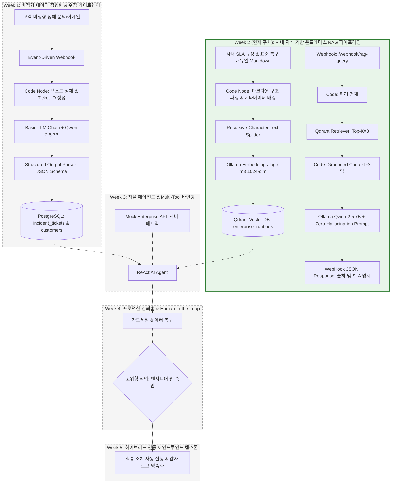
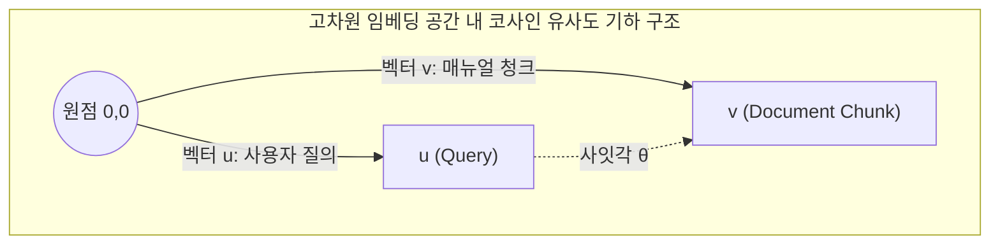
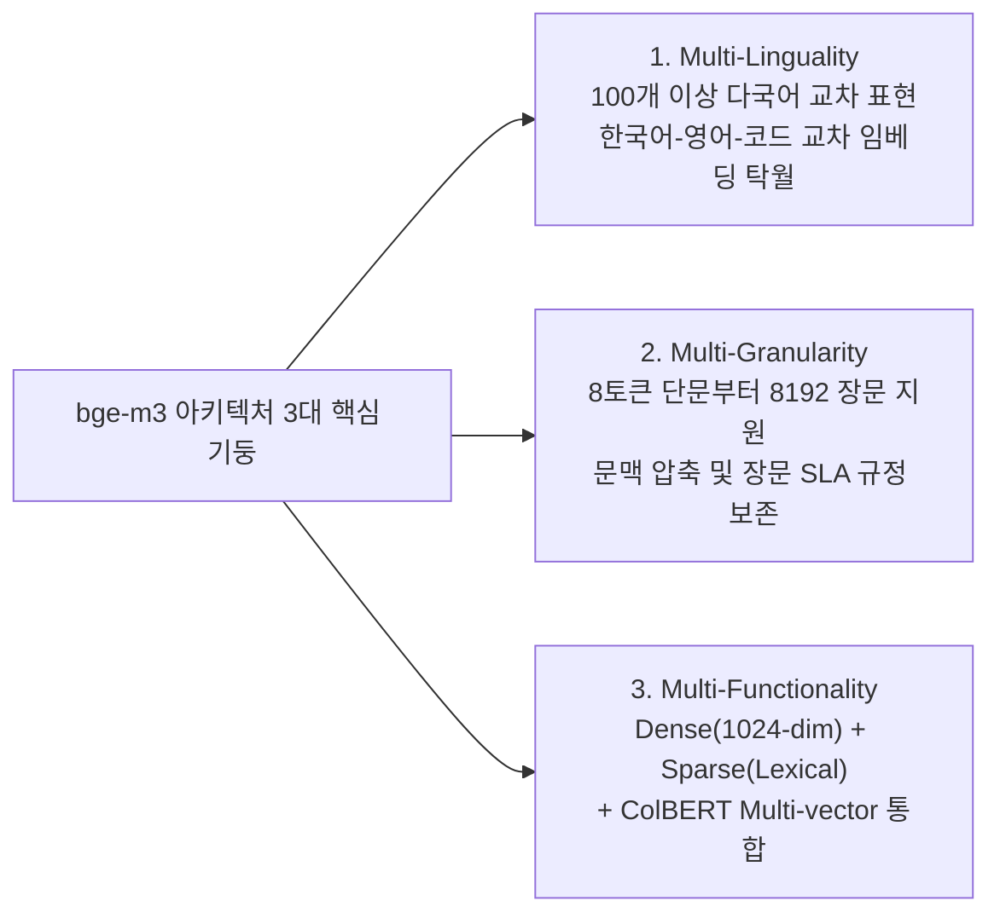
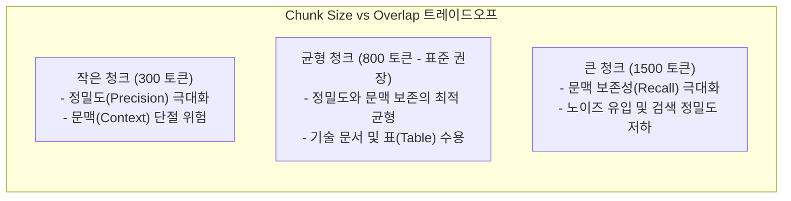
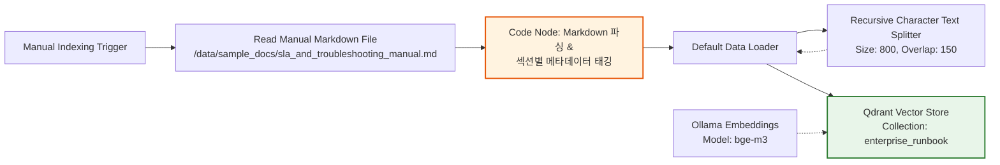
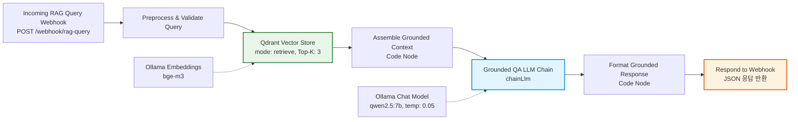

# [Week 02] 온프레미스 RAG 파이프라인과 사내 지식 베이스 구축

> 🏠 [과정 메인 포털](../README.md) ｜ [⏮️ 이전: Week 01 인프라 & 정형 추출](./Week01_Infra_and_Structured_Output.md) ｜ 📥 [Week 02 완성본 워크플로우 JSON](../03_workflows/week02_rag_indexing_and_query.json) ｜ [다음: Week 03 자율 에이전트 ⏭️](./Week03_Agentic_Orchestration_MultiTool.md)

---

## 1. 학습 개요 및 전체 아키텍처 내 위치 (Where We Are)

### 1.1 전체 5주 캡스톤 아키텍처 로드맵
현대 엔터프라이즈 환경에서 인공지능(AI)을 실무 운영 프로세스에 도입할 때 가장 핵심적인 과제는 **"사내 고유의 업무 규정, 보안 지침, 시스템 운영 매뉴얼(Runbook)을 어떻게 AI 모델에 실시간으로, 그리고 환각(Hallucination) 없이 주입할 것인가"**입니다. 아무리 거대한 파라미터를 가진 최신 거대언어모델(LLM)이라 할지라도 사전 학습 데이터셋(Pre-training Dataset)에는 기업 내부의 비공개 운영 정책이나 실시간 인프라 상태가 포함되어 있지 않습니다. 

본 교육과정은 외부 클라우드로의 기밀 데이터 반출이 엄격히 통제된 엔터프라이즈 폐쇄망(Air-gapped Network) 환경을 전제로, 오픈소스 sLM과 온프레미스 벡터 데이터베이스를 결합한 고신뢰성 **검색 증강 생성(Retrieval-Augmented Generation, RAG)** 시스템을 구축합니다.



### 1.2 Week 2 모듈의 핵심 미션
Week 2에서 완성할 모듈은 지능형 ITSM 플랫폼의 두뇌에 사내 지식을 주입하는 **"온프레미스 지식 인덱싱(Indexing) 및 근거 기반(Grounded) 질의응답 파이프라인"**입니다.
수강생은 이번 주차를 통해:
1. 사내 대외비 문서(`sla_and_troubleshooting_manual.md`)를 읽어와 구조화된 메타데이터를 추출하고,
2. BAAI의 최신 다국어 임베딩 모델 `bge-m3`를 사용하여 텍스트 청크를 1024차원 밀집 벡터로 변환한 뒤 고성능 벡터 데이터베이스인 `Qdrant`에 적재합니다.
3. 이어서 외부 인입 질의에 대해 의미론적 코사인 유사도 기반 검색(Top-$K=3$)을 수행하고,
4. 검색된 정밀 컨텍스트만을 바탕으로 답변하도록 제약하는 **환각 방어(Zero-hallucination) 시스템 프롬프트**를 적용하여, 답변의 근거가 된 [문서 섹션]과 [SLA 기준]을 투명하게 반환하는 검증 완료 파이프라인을 구축합니다.

### 1.3 핵심 학습 목표 (Learning Objectives)
- **아키텍처 관점**: 생성형 언어 모델의 지식 단절(Knowledge Cutoff)과 파라메트릭 메모리의 한계로 인한 환각 발생 메커니즘을 정보이론 및 수학적 확률 분포 관점에서 설명할 수 있으며, 기업 환경에서 Fine-tuning 대비 RAG 아키텍처가 지니는 비용·보안·유지보수 우위를 비교 분석할 수 있다.
- **AI 엔지니어링 관점**: 고차원 밀집 벡터 검색(Dense Retrieval)의 기저 원리인 코사인 유사도(Cosine Similarity) 수식을 이해하고, `bge-m3` 다국어 임베딩 아키텍처의 특성을 파악한다. 또한 `Recursive Character Text Splitter`의 Chunk Size(300 vs 800 vs 1500) 및 Overlap 설정이 검색 정밀도(Precision)와 문맥 보존성(Recall)에 미치는 엔지니어링 트레이드오프를 수치 매트릭스로 제시할 수 있다.
- **핸즈온 구현 관점**: n8n 환경에서 `Document Loader` -> `Text Splitter` -> `Ollama Embeddings` -> `Qdrant Vector Store`로 이어지는 오프라인 인덱싱 워크플로우(Lab 2-A)와, `Webhook` -> `Qdrant Retriever` -> `Grounded LLM Chain` -> `Webhook Respond`로 이어지는 실시간 QA 워크플로우(Lab 2-B)를 직접 구축하고 3종의 테스트 케이스를 통해 환각 방어 성능을 검증할 수 있다.

### 1.4 선수 지식 및 실습 환경 요구사항
- **선수 지식**: Week 1에서 실습한 n8n 기초 조작법 및 JSON 표현식(`{{ $json }}`), 선형대수학 기초(벡터 내적, L2 노름), HTTP REST API 및 JSON 데이터 핸들링.
- **실습 환경 및 소프트웨어 스펙**:
  - Docker & Docker Compose: `n8n` (5678), `ollama` (11434), `qdrant` (6333/6334) 정상 구동 상태
  - Ollama 로컬 모델: `bge-m3` (다국어 임베딩 모델), `qwen2.5:7b` (추론 모델)
  - 샘플 문서 마운트: `/data/sample_docs/sla_and_troubleshooting_manual.md`

---

## 2. 전공 CS & AI 엔지니어링 핵심 이론 (Deep Dive)

### 2.1 sLM 환각(Hallucination)의 수학적 원인과 지식 단절(Knowledge Cutoff)

#### (1) 파라메트릭 메모리(Parametric Memory) vs 비파라메트릭 메모리(Non-parametric Memory)
자기회귀(Auto-regressive) 언어 모델은 거대한 텍스트 코퍼스를 사전 학습(Pre-training)하는 과정에서 딥러닝 가중치 행렬(Weight Matrices, $\mathbf{W}$) 내에 지식을 압축하여 저장합니다. 이를 **파라메트릭 메모리(Parametric Memory)**라고 부릅니다.

언어 모델의 텍스트 생성은 이전 토큰 시퀀스 $w_{<t} = (w_1, w_2, \dots, w_{t-1})$가 주어졌을 때, 어휘 사전(Vocabulary, $\mathcal{V}$) 전체에 대한 소프트맥스(Softmax) 조건부 확률 분포로부터 다음 토큰 $w_t$를 샘플링하는 과정입니다:

$$P(w_t \mid w_{<t}) = \text{Softmax}\left(\frac{\mathbf{h}_t \mathbf{W}_v^T}{\tau}\right) = \frac{\exp\left(\mathbf{h}_t \mathbf{w}_{v, i} / \tau\right)}{\sum_{j=1}^{|\mathcal{V}|} \exp\left(\mathbf{h}_t \mathbf{w}_{v, j} / \tau\right)}$$

여기서 $\mathbf{h}_t$는 트랜스포머 디코더의 마지막 은닉 상태(Hidden State) 벡터이며, $\tau$는 샘플링 온도(Temperature)입니다.

이러한 수학적 구조는 다음과 같은 본질적 결함을 내포합니다:
1. **지식 단절(Knowledge Cutoff)**: 모델이 학습된 시점 이후에 제정되거나 변경된 규정(예: 2026년 3월 개정된 사내 ITSM SLA 매뉴얼)은 가중치 $\mathbf{W}$에 존재하지 않습니다.
2. **폐쇄 세계 가정(Closed-World Assumption)의 부재**: 모델은 "내가 이 사실을 모른다"라는 메타 인지(Metacognition) 능력을 기본적으로 갖추지 못합니다. 모델의 목적 함수는 *진실성(Truthfulness)* 검증이 아니라, 언어학적으로 가장 자연스럽고 우도(Likelihood)가 높은 토큰 시퀀스를 완성하는 것이기 때문입니다.
3. **통계적 그럴듯함(Stochastic Plausibility)의 함정**: 가중치 내에 없는 사실(예: "VIP 고객사 DB 장애 시 목표 복구 시간은?")에 직면하면, 모델은 일반적인 인터넷 기술 블로그에서 보았던 유사 문맥의 통계적 평균을 인출하여 "일반적으로 4시간 이내입니다"와 같은 치명적인 거짓 정보를 매우 확신에 찬 어조로 지어냅니다. 이것이 바로 **환각(Hallucination)**의 수학적 실체입니다.

#### (2) 엔터프라이즈 환경에서 Fine-tuning vs RAG 비교 분석
기업 내부 지식을 모델에 반영하는 방법으로는 크게 **지도 미세조정(Supervised Fine-tuning, SFT)**과 **검색 증강 생성(RAG)**이 존재합니다. 엔터프라이즈 환경에서의 비교 분석은 다음과 같습니다:

| 비교 지표 | 모델 파인튜닝 (Fine-tuning / SFT) | 온프레미스 RAG (Retrieval-Augmented) |
| :--- | :--- | :--- |
| **지식 갱신 주기** | 수일~수주 (데이터 수집, LoRA 파인튜닝, 가중치 병합 필요) | **즉각 반영 (Zero-latency)**: 문서 수정 후 Qdrant 인덱싱 즉시 반영 |
| **인프라 비용 및 리소스** | 고사양 GPU 클러스터 및 VRAM 수십 GB 필수 | 경량 임베딩 모델(`bge-m3`) 구동에 필요한 저사양 VRAM/CPU로 충분 |
| **출처 인용 (Auditability)** | 불가능 (블랙박스 신경망 가중치에서 인출되므로 출처 특정 불가) | **완벽한 감사 추적 가능 (Doc ID, Section, Page 넘버 100% 매핑)** |
| **환각(Hallucination) 제어** | 여전히 발생 가능 (확률적 생성 편향 잔존) | **강력한 Grounding System Prompt를 통한 원천 차단 가능** |
| **데이터 권한 관리 (ACL)** | 불가능 (모든 사용자가 동일한 가중치 공유) | **메타데이터 필터링(`security_level`)을 통한 사용자별 문서 접근 제어 가능** |

결론적으로, 정책 규정, 기술 매뉴얼, 고객 계약 조건과 같이 **수치가 정밀해야 하고 빈번히 개정되며 법적/감사적 출처 증빙이 필수적인 엔터프라이즈 업무**에는 RAG 아키텍처가 절대적인 표준입니다.

---

### 2.2 밀집 벡터 검색(Dense Retrieval)과 벡터 유사도 메트릭

#### (1) 어휘 검색(Lexical Search)의 한계와 밀집 의미 검색(Dense Semantic Search)
전통적인 검색 엔진(Elasticsearch, Lucene 등)은 역색인(Inverted Index) 기반의 **어휘 검색(Lexical Search, TF-IDF / BM25)**을 사용합니다.
- 질의: `"DB 커넥션이 꽉 차서 결제가 멈췄을 때 대처법"`
- 문서: `"RDBMS Connection Pool 고갈 인시던트 발생 시 reset-db-pool 조치 절차"`

어휘 검색에서는 `"DB" $\neq$ "RDBMS"`, `"꽉 차서" $\neq$ "고갈"`, `"멈췄을 때" $\neq$ "인시던트"`로 인식되어 형태소/키워드가 완전히 불일치하므로 검색 결과에서 누락(Vocabulary Mismatch)되는 치명적인 문제가 발생합니다.

반면, **밀집 검색(Dense Retrieval)**은 텍스트를 고차원 연속 벡터 공간(Continuous Vector Space, $\mathbb{R}^d$)의 한 점으로 매핑하는 인코더(Encoder) 신경망을 활용합니다. 의미적으로 유사한 개념은 벡터 공간 상에서 서로 가까운 거리에 위치하게 되므로, 키워드가 완전히 다르더라도 의미론적 유사성(Semantic Similarity)을 포착하여 찾아낼 수 있습니다.

#### (2) 코사인 유사도(Cosine Similarity) 수식 및 기하학적 의미
두 개의 $d$차원 임베딩 벡터 $\mathbf{u}, \mathbf{v} \in \mathbb{R}^d$가 주어졌을 때, 두 벡터 사이의 사잇각 $\theta$의 코사인 값을 계산하는 **코사인 유사도(Cosine Similarity)**는 다음과 같이 정의됩니다:

$$\text{Cosine Similarity}(\mathbf{u}, \mathbf{v}) = \cos(\theta) = \frac{\mathbf{u} \cdot \mathbf{v}}{\|\mathbf{u}\|_2 \|\mathbf{v}\|_2} = \frac{\sum_{i=1}^d u_i v_i}{\sqrt{\sum_{i=1}^d u_i^2} \sqrt{\sum_{i=1}^d v_i^2}}$$

- **범위**: $[-1, 1]$ (일반적으로 텍스트 임베딩 공간에서는 비음수 가중치로 인해 $[0, 1]$ 구간에 집중됨)
- **기하학적 의미**: 두 벡터가 가리키는 **방향(Direction)**의 일치도를 측정합니다. 벡터의 길이(크기, Magnitude)는 텍스트의 길이나 특정 단어의 단순 반복 빈도에 영향을 받을 수 있으므로, 크기에 독립적으로 순수한 의미적 지향점만을 비교하기 위해 분모에서 각 벡터의 L2 노름(Norm)으로 나누어 정규화합니다.



#### (3) L2 정규화(L2 Normalization)와 내적(Dot Product)의 수학적 일치
실무 프로덕션 벡터 데이터베이스(`Qdrant`, `pgvector`)에서는 수백만 개의 벡터에 대해 매 검색마다 분모의 L2 노름 $\sqrt{\sum u_i^2}$을 반복 계산하면 막대한 CPU/GPU 부하가 발생합니다.
따라서 임베딩 생성 시점에 모든 벡터를 사전에 **L2 정규화(L2 Normalization)**하여 크기가 1인 단위 벡터(Unit Vector)로 만듭니다:

$$\hat{\mathbf{u}} = \frac{\mathbf{u}}{\|\mathbf{u}\|_2}, \quad \|\hat{\mathbf{u}}\|_2 = 1$$

두 단위 벡터 $\hat{\mathbf{u}}, \hat{\mathbf{v}}$에 대해 코사인 유사도를 구하면:

$$\text{Cosine Similarity}(\hat{\mathbf{u}}, \hat{\mathbf{v}}) = \frac{\hat{\mathbf{u}} \cdot \hat{\mathbf{v}}}{1 \times 1} = \hat{\mathbf{u}} \cdot \hat{\mathbf{v}} = \sum_{i=1}^d \hat{u}_i \hat{v}_i$$

즉, **복잡한 제곱근과 나눗셈 연산이 순수한 하드웨어 가속 부동소수점 곱셈-누적(FMA, Fused Multiply-Add) 내적 연산으로 단순화**됩니다. Qdrant는 이를 통해 수백만 개의 고차원 벡터에 대해 수 밀리초(ms) 단위의 초고속 HNSW(Hierarchical Navigable Small World) 인덱스 탐색을 지원합니다.

---

### 2.3 다국어 고성능 임베딩 모델 `bge-m3` 내부 아키텍처

본 실습에서 사용하는 `bge-m3`(BAAI/bge-m3)는 베이징인공지능연구원(BAAI)에서 발표한 오픈소스 최고 성능의 다국어 임베딩 모델입니다. `bge-m3`의 명칭은 다음의 세 가지 **M3** 아키텍처 특성에서 유래합니다:



1. **Multi-Linguality (다국어 지원)**:
   - 전 세계 100개 이상의 언어를 지원하며, 특히 한국어(Korean)와 영어(English)가 혼용된 엔터프라이즈 IT 기술 문서(예: "WAS의 JVM Heap Memory Full GC 주기")를 완벽하게 인코딩합니다.
2. **Multi-Granularity (다양한 입력 단위)**:
   - 기존의 대다수 임베딩 모델(`all-MiniLM-L6-v2`, `text-embedding-ada-002`)이 512토큰 수준의 짧은 컨텍스트만 지원했던 것과 달리, **최대 8,192 토큰**의 긴 컨텍스트 윈도우를 지원합니다. 이를 통해 복잡한 사내 기술 아키텍처 명세서나 장문의 표준 운영 절차서(SOP)를 정보 손실 없이 한 번에 인코딩할 수 있습니다.
3. **Multi-Functionality (다중 검색 모드)**:
   - 밀집 검색(Dense Retrieval, 1024차원 가중치 벡터)
   - 희소 검색(Sparse Retrieval, 단어별 가중치 기반 BM25 유사 렉시컬 검색)
   - 다중 벡터 검색(Multi-Vector, ColBERT 스타일의 토큰 단위 세밀한 정렬 검색)
   - 본 실습에서는 표준 엔터프라이즈 환경에서 가장 널리 사용되는 **1024차원 Dense Embedding** 방식을 Qdrant와 연동하여 사용합니다.

---

### 2.4 문서 청킹(Chunking) 전략과 엔지니어링 트레이드오프

#### (1) 청킹(Chunking)이 필수적인 이유
아무리 8,192 토큰을 지원하는 `bge-m3`라 할지라도, 100페이지 분량의 매뉴얼 전체를 하나의 벡터로 압축하면 안 됩니다.
1. **평균화에 따른 정보 희석(Dilution in Mean-Pooling)**: 수천 개의 토큰이 하나의 1024차원 벡터로 평균 풀링(Mean Pooling)되면, 특정 조항(예: "VIP 등급 최초 응답 시간은 15분")의 날카로운 세부 정보가 전체 문서의 평균적 의미 속에 파묻혀 검색되지 않습니다.
2. **LLM 컨텍스트 윈도우 및 추론 비용 절감**: 검색된 문서를 LLM의 프롬프트에 주입할 때, 질문과 무관한 수십 페이지의 텍스트가 들어가면 LLM의 주의 집중(Attention)이 분산되어 오히려 오답을 유발하고 토큰 처리 비용과 지연시간(Latency)이 급증합니다.

#### (2) Recursive Character Text Splitter의 계층적 분할 메커니즘
`Recursive Character Text Splitter`는 문서를 임의의 바이트나 토큰 위치에서 무작정 자르지 않고, 사람이 글을 작성할 때 사용하는 문법적 구조를 존중하여 분할하는 LangChain의 대표적인 분할 알고리즘입니다.

분할 구분자(Separator) 우선순위 리스트:
```python
separators = ["\n\n", "\n", " ", ""]
```

1. **1순위 (`\n\n`)**: 문단(Paragraph) 경계를 기준으로 먼저 나눕니다. 문단 내에서 의미가 완결되므로 가장 이상적인 분할입니다.
2. **2순위 (`\n`)**: 문단 하나가 지정된 `chunkSize`를 초과할 경우, 줄바꿈(Line break) 기준으로 문장을 나눕니다.
3. **3순위 (` `)**: 한 줄의 문장조차 너무 길 경우, 단어 공백(Space)을 기준으로 단어가 잘리지 않게 나눕니다.
4. **4순위 (`""`)**: 단어 자체가 `chunkSize`보다 긴 비정상적인 문자열일 때만 최종적으로 글자 단위로 강제 절단합니다.

#### (3) Chunk Size & Overlap 트레이드오프 비교 매트릭스
실무 RAG 시스템 설계 시 엔지니어가 반드시 결정해야 하는 파라미터는 **Chunk Size(청크 크기)**와 **Chunk Overlap(청크 중첩 크기)**입니다.



| 평가 지표 | 300 토큰 (Small Chunk) | 800 토큰 (Medium Chunk - 권장) | 1,500 토큰 (Large Chunk) |
| :--- | :--- | :--- | :--- |
| **청크 중첩 (Overlap)** | 50 토큰 권장 | **150 토큰 권장** | 300 토큰 권장 |
| **검색 정밀도 (Precision)** | **매우 높음** (정확한 한두 문장 검색) | **높음** (연관 문단 중심 정밀 인출) | **낮음** (무관한 전후 문맥이 다수 혼입) |
| **문맥 보존성 (Recall)** | **낮음** (표나 절차서가 중간에 잘림) | **우수** (하나의 완전한 SOP 단위 포함) | **매우 우수** (전체 섹션 흐름 완벽 유지) |
| **표(Markdown Table) 보존율** | **극히 취약** (헤더와 데이터 행 분단) | **우수** (대부분의 표준 표가 단일 청크에 수용) | **완벽** (복합 다단 표 전체 온전히 수용) |
| **인덱싱 청크 개수 및 DB 용량** | 문서당 청크 수 급증 (연산량 3배) | **적정 수준 (엔지니어링 표준)** | 청크 수 최소화 (저장 공간 절약) |
| **권장 적용 시나리오** | 단순 단답형 FAQ, 사전 정의 용어집 | **엔터프라이즈 장애 SOP, SLA 규정집** | 방대한 법률 계약서, 감사 보고서 요약 |

> **엔지니어링 결론**: 사내 ITSM 매뉴얼은 표(SLA 매트릭스), 단계별 장애 복구 절차(Step 1~4), 코드/JSON 페이로드 스펙을 모두 포함하고 있으므로, 표가 잘리지 않으면서도 검색 정밀도를 유지할 수 있는 **Chunk Size: 800, Chunk Overlap: 150** 설정이 최적의 골디락스(Goldilocks) 구간입니다.

---

## 3. 실습 환경 사전 점검 (Pre-flight Check)

실습을 시작하기 전, Docker Compose로 구성된 온프레미스 인프라의 컨테이너 상태와 필수 AI 모델이 정상 준비되었는지 터미널에서 점검합니다.

### 3.1 컨테이너 헬스체크
터미널(PowerShell 또는 Bash)에서 다음 명령어를 실행하여 5개 핵심 컨테이너가 정상 구동 중인지 확인합니다:

```bash
docker compose -f 02_lab_environments/docker-compose.yml ps
```

- **정상 출력 기준**:
  - `n8n`: Up (healthy 또는 running, 포트 `5678`)
  - `ollama`: Up (running, 포트 `11434`)
  - `qdrant`: Up (running, 포트 `6333`, `6334`)
  - `postgres`: Up (healthy, 포트 `5432`)
  - `mock-enterprise-api`: Up (running, 포트 `8000`)

### 3.2 Ollama 임베딩 모델(`bge-m3`) 및 추론 모델(`qwen2.5:7b`) 점검
Ollama 컨테이너에 이번 실습에 필요한 임베딩 모델과 언어 모델이 정상 다운로드되어 있는지 확인합니다:

```bash
# 로컬 모델 목록 조회
curl -s http://localhost:11434/api/tags | jq .

# bge-m3 모델이 없는 경우 즉시 다운로드 (약 1.2GB)
docker exec -it ollama ollama pull bge-m3

# qwen2.5:7b 모델 다운로드 확인 (Week 1에서 미수행 시)
docker exec -it ollama ollama pull qwen2.5:7b
```

### 3.3 Ollama 로컬 임베딩 생성 API 직접 테스트
`bge-m3` 모델이 1024차원의 밀집 임베딩 벡터를 정상적으로 출력하는지 `curl`로 직접 검증합니다:

```bash
curl -X POST http://localhost:11434/api/embeddings \
  -H "Content-Type: application/json" \
  -d '{
    "model": "bge-m3",
    "prompt": "사내 데이터베이스 커넥션 풀 고갈 장애 대응 매뉴얼"
  }' | jq '.embedding | length'
```

- **기대 결과**: `1024` (1024개의 부동소수점 실수 배열 정상 반환)

### 3.4 Qdrant 벡터 데이터베이스 연결 및 웹 UI 확인
브라우저에서 `http://localhost:6333/dashboard`에 접속하거나, 터미널에서 헬스체크 API를 호출합니다:

```bash
curl -s http://localhost:6333/readyz
# 정상 응답: all systems are ready
```

---

## 4. Step-by-Step 핸즈온 Lab 2-A: 사내 지식 인덱싱 파이프라인

### 4.1 파이프라인 아키텍처 및 데이터 흐름
Lab 2-A의 목표는 볼륨으로 마운트된 사내 매뉴얼 원본 마크다운 파일을 로드하여, 구조적 메타데이터를 추출하고, 청킹 및 벡터 임베딩을 거쳐 Qdrant의 `enterprise_runbook` 컬렉션에 적재하는 것입니다.



### 4.2 노드별 상세 파라미터 구성표

| 순서 | 노드 명칭 (Node Name) | n8n 노드 타입 (Node Type) | 핵심 설정 파라미터 (Parameters) |
| :---: | :--- | :--- | :--- |
| **1** | `Manual Indexing Trigger` | `manualTrigger` | 실행 버튼 클릭 시 1회 수동 실행 |
| **2** | `Read Manual Markdown File` | `readWriteFile` | `operation`: `read`<br/>`filePath`: `/data/sample_docs/sla_and_troubleshooting_manual.md`<br/>`dataPropertyName`: `data` |
| **3** | `Parse Markdown and Inject Metadata` | `code` (JavaScript) | 대단원(`## `) 기준 1차 분할, 문서 ID(`doc_id`), 버전(`doc_version`), 보안등급(`security_level`), 섹션명(`section`) 구조화 |
| **4** | `Default Data Loader` | `@n8n/n8n-nodes-langchain.documentDefaultDataLoader` | `dataType`: `json`<br/>`jsonContent`: `={{ $json.text }}`<br/>메타데이터 필드 매핑 (`doc_id`, `section`, `security_level`) |
| **5** | `Recursive Character Text Splitter` | `@n8n/n8n-nodes-langchain.textSplitterRecursiveCharacterTextSplitter` | `chunkSize`: `800`<br/>`chunkOverlap`: `150`<br/>`splitCode`: `false` |
| **6** | `Ollama Embeddings (bge-m3)` | `@n8n/n8n-nodes-langchain.embeddingsOllama` | `model`: `bge-m3`<br/>`Base URL`: `http://ollama:11434` |
| **7** | `Qdrant Vector Store (Index)` | `@n8n/n8n-nodes-langchain.vectorStoreQdrant` | `mode`: `insert`<br/>`qdrantCollection`: `enterprise_runbook`<br/>Credentials: `http://qdrant:6333` |

### 4.3 `Code Node`: 마크다운 구조화 및 메타데이터 주입 스크립트 전문
마크다운 문서를 통째로 넣으면 섹션 헤더나 문서 번호가 유실되므로, 자바스크립트 정규식을 통해 문서 전역 메타데이터를 추출하고 대단원별로 1차 분할하는 코드를 작성합니다.

```javascript
// ==============================================================================
// Week 2: 사내 매뉴얼 마크다운 로드 및 구조화 메타데이터 주입
// ==============================================================================
const item = $input.first();
let textContent = "";

// 1. 바이너리 버퍼(파일 읽기 노드 출력) 또는 텍스트 입력 처리
if (item.binary && item.binary.data) {
  const binaryBuffer = Buffer.from(item.binary.data.data, 'base64');
  textContent = binaryBuffer.toString('utf-8');
} else if (item.json && item.json.content) {
  textContent = item.json.content;
} else if (typeof item.json === 'string') {
  textContent = item.json;
} else {
  textContent = JSON.stringify(item.json);
}

// 2. 문서 헤더 메타데이터 정규식 추출
const docIdMatch = textContent.match(/문서 번호[\*\s]*:[\s]*`?([A-Za-z0-9_-]+)`?/);
const docVersionMatch = textContent.match(/문서 버전[\*\s]*:[\s]*`?([vV0-9.]+)?`?/);
const secLevelMatch = textContent.match(/보안 등급[\*\s]*:[\s]*([가-힣A-Za-z\s\(\)]+)/);

const docId = docIdMatch ? docIdMatch[1] : "DOC-ITSM-2026-SOP";
const docVersion = docVersionMatch ? docVersionMatch[1] : "v3.4";
const securityLevel = secLevelMatch ? secLevelMatch[1].trim() : "Internal Enterprise Confidential";

// 3. 마크다운 대단원(## ) 단위로 1차 분할하여 논리적 섹션 보존
const rawSections = textContent.split(/(?=^##\s+)/m);
const documents = [];

for (let i = 0; i < rawSections.length; i++) {
  const sectionBlock = rawSections[i].trim();
  if (!sectionBlock) continue;

  // 섹션 제목 추출 (첫 번째 행의 ## 제거)
  const firstLine = sectionBlock.split('\n')[0].replace(/^##\s*/, '').trim();
  const sectionName = firstLine.length > 0 ? firstLine : `Section-${i}`;

  documents.push({
    json: {
      text: sectionBlock,
      metadata: {
        doc_id: docId,
        doc_version: docVersion,
        security_level: securityLevel,
        section_index: i,
        section: sectionName,
        indexed_at: new Date().toISOString(),
        source: "/data/sample_docs/sla_and_troubleshooting_manual.md"
      }
    }
  });
}

return documents;
```

### 4.4 인덱싱 실행 및 Qdrant REST API 검증
n8n 캔버스에서 `Manual Indexing Trigger`의 **[Test step]** 또는 **[Execute Workflow]**를 클릭하여 인덱싱을 수행합니다. 
성공적으로 완료된 후, 호스트 터미널에서 Qdrant REST API를 호출하여 벡터 포인트가 정상적으로 적재되었는지 검증합니다:

```bash
# 1. enterprise_runbook 컬렉션 상태 및 벡터 개수 확인
curl -s http://localhost:6333/collections/enterprise_runbook | jq .

# 2. 적재된 총 포인트(벡터 청크) 개수 확인
curl -s http://localhost:6333/collections/enterprise_runbook/points/count | jq .

# 3. 샘플 포인트 페이로드(메타데이터) 직접 조회 (1건)
curl -s -X POST http://localhost:6333/collections/enterprise_runbook/points/scroll \
  -H "Content-Type: application/json" \
  -d '{"limit": 1, "with_payload": true, "with_vector": false}' | jq .
```

- **예상 응답 스냅샷 (Qdrant Point Count)**:
```json
{
  "result": {
    "count": 7
  },
  "status": "ok",
  "time": 0.002
}
```

---

## 5. Step-by-Step 핸즈온 Lab 2-B: 근거 기반(Grounded) 질의응답 및 출처 검증 파이프라인

### 5.1 파이프라인 아키텍처 및 데이터 흐름
Lab 2-B의 목표는 실시간 질의(Webhook)를 수신하여, Qdrant 벡터 DB로부터 가장 유사한 Top-3 매뉴얼 청크를 검색한 뒤, **"컨텍스트 외의 내용은 절대 답변하지 말 것"**을 강제하는 환각 방어 프롬프트와 함께 sLM(`Qwen 2.5 7B`)에 전달하여 정밀한 답변과 출처 메타데이터를 반환하는 것입니다.



### 5.2 노드별 상세 파라미터 구성표

| 순서 | 노드 명칭 (Node Name) | n8n 노드 타입 (Node Type) | 핵심 설정 파라미터 (Parameters) |
| :---: | :--- | :--- | :--- |
| **1** | `Incoming RAG Query Webhook` | `webhook` | `httpMethod`: `POST`<br/>`path`: `rag-query`<br/>`responseMode`: `responseNode` |
| **2** | `Preprocess and Validate Query` | `code` (JavaScript) | 입력 페이로드에서 `query`, `company_name`, `contract_tier` 추출 및 누락 시 예외 발생 |
| **3** | `Qdrant Vector Store (Retrieve)` | `@n8n/n8n-nodes-langchain.vectorStoreQdrant` | `mode`: `retrieve`<br/>`qdrantCollection`: `enterprise_runbook`<br/>`prompt`: `={{ $json.query }}`<br/>`topK`: `3` |
| **4** | `Ollama Embeddings for Query` | `@n8n/n8n-nodes-langchain.embeddingsOllama` | `model`: `bge-m3`<br/>`Base URL`: `http://ollama:11434` |
| **5** | `Assemble Grounded Context` | `code` (JavaScript) | 검색된 3개 청크 본문과 메타데이터(`doc_id`, `section`, `security_level`)를 단일 컨텍스트 블록으로 포맷팅 |
| **6** | `Grounded QA LLM Chain` | `@n8n/n8n-nodes-langchain.chainLlm` | `promptType`: `define`<br/>환각 방어 및 출처 명시 System Prompt 전문 적용 |
| **7** | `Ollama Qwen 2.5 7B` | `@n8n/n8n-nodes-langchain.lmChatOllama` | `model`: `qwen2.5:7b`<br/>`temperature`: `0.05` (결정론적 답변 유도) |
| **8** | `Format Grounded Response` | `code` (JavaScript) | 답변 본문, 인용 섹션 리스트, 환각 방어 거절 여부(`grounding_verified`) 구조화 |
| **9** | `Respond to Webhook` | `respondToWebhook` | `respondWith`: `json`<br/>`responseBody`: `={{ JSON.stringify($json) }}` |

### 5.3 환각 방어 Grounding System Prompt 전문
sLM이 없는 지식을 창작하지 못하도록 통제하는 핵심 프롬프트입니다:

```text
당신은 사내 엔터프라이즈 ITSM 기술 지원 및 SLA 규정 준수 전문 AI 엔지니어입니다.
반드시 아래 제공된 [사내 공식 매뉴얼 컨텍스트]에만 철저히 근거하여 질문에 답변하십시오.

[환각(Hallucination) 방어 절대 준수 규칙]:
1. 제공된 컨텍스트 외의 사외 지식, 일반적 IT 상식, 개인적 추론은 절대 답변에 포함하지 마십시오.
2. 질문에 해당하는 명확한 근거가 제공된 컨텍스트에 없을 경우, 절대로 답을 지어내지 말고 반드시 다음과 같이 명시하십시오: "사내 표준 매뉴얼에서 해당 규정 또는 조치 절차를 확인할 수 없습니다."
3. 답변 작성 시 반드시 참조한 [문서 섹션]과 [SLA 기준]을 명확히 명시하십시오.
4. 고객사 계약 등급(VIP, Enterprise, Standard)에 따라 규정이 상이한 경우 질문자의 등급을 식별하여 정확한 수치(응답 시간, MTTR, 보상률)를 인용하십시오.

[고객사 및 질의 정보]:
- 고객사명: {{ $json.company_name }}
- 계약 등급: {{ $json.contract_tier }}
- 사용자 질의: {{ $json.query }}

[사내 공식 매뉴얼 컨텍스트]:
{{ $json.context }}

위 컨텍스트에 입각한 전문적이고 신뢰성 있는 답변을 개조식으로 명확히 제시하십시오.
```

### 5.4 엔드투엔드 `curl` 검증 테스트 케이스 3종

#### 📌 [테스트 케이스 1: 정상 매뉴얼 기반 질문 (VIP 고객사 DB 커넥션 풀 장애 대응)]
- **목적**: VIP 고객사의 DB 풀 고갈 장애 발생 시 규정된 최초 응답 시간, 복구 목표 시간(MTTR), 조치 엔드포인트가 정확히 인용되는지 확인.
- **실행 명령어**:
```bash
curl -X POST http://localhost:5678/webhook/rag-query \
  -H "Content-Type: application/json" \
  -d '{
    "company_name": "(주)대한전자",
    "contract_tier": "VIP",
    "query": "당사는 VIP 고객사인데 db-primary-01의 DB 커넥션 풀 사용률이 92%에 도달했습니다. 최초 응답 SLA 시간과 복구 목표 시간은 얼마이며 어떤 복구 조치 API가 실행되어야 합니까?"
  }' | jq .
```

- **예상 응답 페이로드 (JSON)**:
```json
{
  "status": "success",
  "query": "당사는 VIP 고객사인데 db-primary-01의 DB 커넥션 풀 사용률이 92%에 도달했습니다. 최초 응답 SLA 시간과 복구 목표 시간은 얼마이며 어떤 복구 조치 API가 실행되어야 합니까?",
  "company_name": "(주)대한전자",
  "contract_tier": "VIP",
  "answer": "1. [참조 섹션]: 1.2 계약 등급별 SLA 대응 및 복구 목표 시간 매트릭스\n   - VIP 고객사 목표 최초 응답 시간: **15분 이내** (최우선 긴급 배정, 전담 AM 통보 5분 이내)\n   - VIP 고객사 목표 복구 시간(MTTR - Critical): **60분 이내** (매 15분 단위 현황 공유)\n\n2. [참조 섹션]: 3.1 [Runbook-01] RDBMS 데이터베이스 커넥션 풀 고갈 장애\n   - **임계치 검증**: db-primary-01 서버의 pool_usage_pct가 90.0% 이상으로 지속되므로 Runbook-01 적용 대상입니다.\n   - **위험도 및 HITL 승인**: VIP 고객사 대상 DB 풀 초기화는 고위험 액션이므로 AI가 단독 실행할 수 없으며, 반드시 당직 온콜 리드(Lead SRE)의 사전 승인을 획득해야 합니다.\n   - **조치 실행 API**: 승인 완료 후 `POST /api/v1/actions/reset-db-pool` 엔드포인트를 호출하여 커넥션을 강제 회수합니다.",
  "grounding_verified": true,
  "referenced_sections": [
    "1. 사내 서비스 수준 계약(SLA) 정책 및 고객사 계약 등급별 보장 규정",
    "3. 장애 유형별 표준 복구 절차서 (Standard Runbooks / SOP)"
  ],
  "chunks_retrieved_count": 3,
  "processed_at": "2026-11-09T07:15:30.123Z"
}
```

---

#### 📌 [테스트 케이스 2: 환각 방어(Zero-hallucination) 거절 질문 (사내 규정에 없는 외부 기술 질의)]
- **목적**: 사내 매뉴얼에 존재하지 않는 외부 퍼블릭 클라우드 서비스(AWS Lambda)에 대해 질문했을 때, 모델이 그럴듯하게 지어내지 않고 정확히 거절하는지 검증.
- **실행 명령어**:
```bash
curl -X POST http://localhost:5678/webhook/rag-query \
  -H "Content-Type: application/json" \
  -d '{
    "company_name": "한빛바이오랩",
    "contract_tier": "Enterprise",
    "query": "사내 AWS Lambda 함수의 실행 타임아웃 SLA 기준과 비용 환불 정책은 어떻게 됩니까?"
  }' | jq .
```

- **예상 응답 페이로드 (JSON)**:
```json
{
  "status": "success",
  "query": "사내 AWS Lambda 함수의 실행 타임아웃 SLA 기준과 비용 환불 정책은 어떻게 됩니까?",
  "company_name": "한빛바이오랩",
  "contract_tier": "Enterprise",
  "answer": "사내 표준 매뉴얼에서 해당 규정 또는 조치 절차를 확인할 수 없습니다.\n제공된 사내 운영 정책 문서는 당사의 온프레미스 클라우드 플랫폼 인프라(RDBMS, WAS, SSO 인증 게이트웨이)에 관한 내용만을 다루고 있으며, AWS Lambda 관련 SLA 및 환불 기준은 명시되어 있지 않습니다.",
  "grounding_verified": false,
  "referenced_sections": [
    "1. 사내 서비스 수준 계약(SLA) 정책 및 고객사 계약 등급별 보장 규정"
  ],
  "chunks_retrieved_count": 3,
  "processed_at": "2026-11-09T07:16:45.456Z"
}
```

---

#### 📌 [테스트 케이스 3: 복합 조치 기준 질의 (Enterprise 등급 메모리 누수 권한 및 보상 기준)]
- **목적**: 장애 유형(WAS 메모리 누수 Runbook-02)과 고객사 계약 등급(Enterprise)에 따른 작업 승인 권한(Low Risk 자동 실행 가능 여부) 및 초과 시 보상 크레딧 산정 기준을 복합 인출하는지 검증.
- **실행 명령어**:
```bash
curl -X POST http://localhost:5678/webhook/rag-query \
  -H "Content-Type: application/json" \
  -d '{
    "company_name": "넥서스로지스틱스(주)",
    "contract_tier": "Enterprise",
    "query": "Enterprise 고객사 WAS에서 힙 메모리 92% 누수가 발생했습니다. 사람 승인 없이 재기동할 수 있습니까? 만약 복구 목표 시간(180분)을 초과하면 서비스 크레딧 보상률은 몇 %입니까?"
  }' | jq .
```

- **예상 응답 페이로드 (JSON)**:
```json
{
  "status": "success",
  "query": "Enterprise 고객사 WAS에서 힙 메모리 92% 누수가 발생했습니다. 사람 승인 없이 재기동할 수 있습니까? 만약 복구 목표 시간(180분)을 초과하면 서비스 크레딧 보상률은 몇 %입니까?",
  "company_name": "넥서스로지스틱스(주)",
  "contract_tier": "Enterprise",
  "answer": "1. [참조 섹션]: 3.2 [Runbook-02] 애플리케이션 WAS 메모리 누수(OOM / Heap Exhaustion) 대응\n   - **사람 승인 여부 (재기동 가능)**: 해당 WAS 서비스는 K8s Replica 4대 이상으로 다중화되어 있으므로 단일 노드 롤링 재기동은 **저위험(Low Risk)** 액션으로 분류됩니다. 따라서 별도의 사람 승인 대기 없이 즉시 대상 파드의 트래픽을 차단하고 자동 롤링 재기동을 수행할 수 있습니다.\n\n2. [참조 섹션]: 1.3 SLA 위반 시 보상 크레딧(Service Credit) 산정 및 지급 규정\n   - **Enterprise 고객사 보상 기준**: 누적 다운타임이 목표 복구 시간인 180분을 초과할 경우, 당월 청구 기본 이용료의 **15%**가 서비스 크레딧으로 보상 지급됩니다.\n   - **최초 응답 시간 초과 시**: 60분 초과 시 당월 청구액의 **5%**가 보상됩니다.",
  "grounding_verified": true,
  "referenced_sections": [
    "3. 장애 유형별 표준 복구 절차서 (Standard Runbooks / SOP)",
    "1. 사내 서비스 수준 계약(SLA) 정책 및 고객사 계약 등급별 보장 규정"
  ],
  "chunks_retrieved_count": 3,
  "processed_at": "2026-11-09T07:18:10.789Z"
}
```

---

## 6. 실무 트러블슈팅 가이드 (Common Pitfalls & Debugging)

수강생들이 n8n과 Qdrant, Ollama를 컨테이너 환경에서 처음 연동할 때 빈발하는 대표적인 에러 TOP 3와 해결책입니다.

### ⚠️ Pitfall 1: 컨테이너 간 통신 시 `localhost` 오지정 에러 (`ECONNREFUSED 127.0.0.1:6333`)
- **현상**: n8n 워크플로우 실행 시 Qdrant 노드 또는 Ollama 노드에서 `connect ECONNREFUSED 127.0.0.1:6333` 또는 `127.0.0.1:11434` 에러가 발생하며 파이프라인이 즉시 중단됨.
- **발생 원인**: `localhost`(127.0.0.1)는 **해당 프로세스가 실행 중인 컨테이너 자체의 루프백 네트워크**를 가리킵니다. n8n 컨테이너 내부에서 `localhost:6333`을 호출하면 n8n 컨테이너 자체에는 Qdrant 프로세스가 없으므로 연결이 거부됩니다.
- **해결책**:
  - `docker-compose.yml`에서 동일한 브릿지 네트워크(`ai-native-net`)로 묶여 있으므로, 호스트 주소에 반드시 **도커 서비스명(Service Hostname)**을 사용해야 합니다.
  - Ollama Base URL: `http://ollama:11434` (호스트의 `http://localhost:11434`가 아님)
  - Qdrant REST URL: `http://qdrant:6333`
  - *(단, macOS Apple Silicon에서 호스트 머신에 직접 설치된 로컬 Ollama를 사용할 경우에만 `http://host.docker.internal:11434`를 사용합니다.)*

---

### ⚠️ Pitfall 2: Qdrant 컬렉션 벡터 차원(Dimension) 불일치 에러 (`Vector dimension error`)
- **현상**: 인덱싱 노드 실행 시 `Wrong input: Vector dimension error: expected 1536, got 1024` 또는 `Distance metric mismatch` 에러 발생.
- **발생 원인**: 이전에 OpenAI(`text-embedding-ada-002`, 1536차원) 등으로 생성했던 컬렉션이 남아있거나, 거리 메트릭이 `Cosine`이 아닌 `Euclidean`으로 설정된 기존 컬렉션에 `bge-m3`(1024차원) 벡터를 삽입하려 할 때 발생합니다.
- **해결책**:
  - 기존 충돌 컬렉션을 삭제하고 1024차원 Cosine 메트릭으로 명시적 재생성합니다:
```bash
# 1. 기존 컬렉션 삭제
curl -X DELETE http://localhost:6333/collections/enterprise_runbook

# 2. 1024차원 Cosine 컬렉션 수동 초기화 생성
curl -X PUT http://localhost:6333/collections/enterprise_runbook \
  -H "Content-Type: application/json" \
  -d '{
    "vectors": {
      "size": 1024,
      "distance": "Cosine"
    }
  }'
```

---

### ⚠️ Pitfall 3: 마크다운 표(Table) 청킹 분단 현상 및 줄바꿈 손실
- **현상**: SLA 매트릭스 표(Table) 관련 질문을 했을 때, 모델이 "해당 표의 수치를 찾을 수 없습니다"라고 오답을 내거나 잘못된 행의 값을 인용함.
- **발생 원인**: `chunkSize`가 너무 작거나(예: 300자), `Recursive Character Text Splitter`가 표 중간의 개행(`\n`)에서 테이블을 반토막 내어 헤더 행(`| 등급 | 응답 시간 |`)과 실제 데이터 행(`| VIP | 15분 |`)이 서로 다른 청크로 쪼개져 의미가 유실되었기 때문입니다.
- **해결책**:
  1. `chunkSize`를 최소 **800** 이상으로 설정하고, `chunkOverlap`을 **150** 이상 부여하여 표의 전후 행이 중첩 청크에 보존되도록 합니다.
  2. 표가 포함된 중요 마크다운 섹션은 Lab 2-A의 `Code Node`처럼 대단원(`## `) 단위로 1차 분할한 후 청킹을 수행하여 논리적 완결성을 확보합니다.

---

## 7. 심화 미니 과제 (Challenge) 및 자가 점검 루브릭

### 🚀 PBL 심화 미니 과제

#### [과제 1: 메타데이터 필터링(Metadata Filter) 기반 조건부 검색 구현]
- **배경**: 보안 등급이 높은 대외비 문서는 권한이 없는 일반 사용자나 외부 API에 노출되어서는 안 됩니다.
- **요구사항**: 
  - Lab 2-B의 `Qdrant Vector Store (Retrieve)` 노드에서 Qdrant 필터 조건(`filter`)을 추가하여, `security_level`이 `"Internal Enterprise Confidential"`인 문서만 대상으로 검색하거나, 특정 `section`이 `"1. 사내 서비스 수준 계약(SLA) 정책 및 고객사 계약 등급별 보장 규정"`인 청크만 제한적으로 검색하도록 워크플로우를 수정하고 그 결과를 캡처하여 제출하십시오.
- **힌트**: Qdrant REST API 필터 문법:
  ```json
  {
    "must": [
      { "key": "metadata.security_level", "match": { "value": "Internal Enterprise Confidential" } }
    ]
  }
  ```

#### [과제 2: 하이브리드 검색(Hybrid Search) 파이프라인 아키텍처 설계안 작성]
- **배경**: 밀집 벡터 검색(Dense Retrieval)은 의미론적 파악에 강하지만, 고유 모델명(예: `db-primary-01`, `app-was-01`)이나 에러 코드(예: `DOC-ITSM-2026-SOP`)와 같은 정확한 키워드 매칭에는 BM25와 같은 어휘 검색이 더 강력합니다.
- **요구사항**:
  - PostgreSQL의 Full-Text Search(또는 pgvector BM25)와 Qdrant Dense Vector 검색 결과를 동시에 수행한 뒤 결합하는 **Reciprocal Rank Fusion (RRF)** 알고리즘 기반 하이브리드 RAG 파이프라인 흐름도를 Mermaid 다이어그램으로 설계하고, RRF 수식을 서술하십시오.

---

### 📋 수강생 자가 점검 루브릭 (Self-Assessment Rubric)

| 평가 영역 | 기본 충족 (Pass / 70점) | 우수 (Good / 85점) | 탁월 (Excellent / 100점) |
| :--- | :--- | :--- | :--- |
| **이론적 이해도 (30%)** | sLM 환각 원인과 RAG 필요성을 구두로 설명할 수 있음. | 코사인 유사도 수식과 `bge-m3`의 1024차원 L2 정규화 내적 가속 원리를 수식으로 증명할 수 있음. | Chunk Size(300 vs 800 vs 1500) 트레이드오프 매트릭스를 기반으로 도메인별 최적 청킹 파라미터를 정량적으로 제시할 수 있음. |
| **인덱싱 구현 (35%)** | n8n을 통해 마크다운 문서를 Qdrant에 에러 없이 적재할 수 있음. | 마크다운 헤더에서 메타데이터(`doc_id`, `section`, `security_level`)를 정규식으로 파싱하여 Qdrant 페이로드에 완벽히 매핑함. | Qdrant REST API(`curl`)를 활용하여 컬렉션 상태, 총 포인트 개수, 개별 페이로드를 직접 검증할 수 있음. |
| **Grounded QA 및 환각 방어 (35%)** | Webhook 질의에 대해 Qdrant 검색 결과를 LLM 프롬프트에 주입하여 답변을 생성함. | 환각 방어 프롬프트를 통해 매뉴얼에 없는 질문 인입 시 정확한 거절 응답을 반환하고 출처 섹션을 명시함. | 3종의 테스트 케이스(정상 질의, 환각 유도 질의, 복합 정책 질의)를 `curl`로 완벽히 통과하고 메타데이터 필터링까지 응용함. |


---

> 🏠 [과정 메인 포털](../README.md) ｜ [⏮️ 이전: Week 01 인프라 & 정형 추출](./Week01_Infra_and_Structured_Output.md) ｜ 📥 [Week 02 완성본 워크플로우 JSON](../03_workflows/week02_rag_indexing_and_query.json) ｜ [다음: Week 03 자율 에이전트 & Multi-Tool ⏭️](./Week03_Agentic_Orchestration_MultiTool.md)
