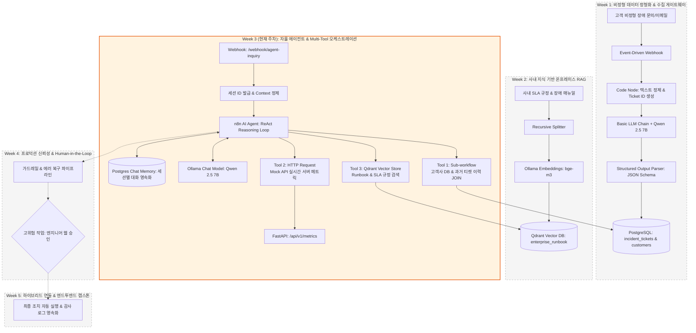
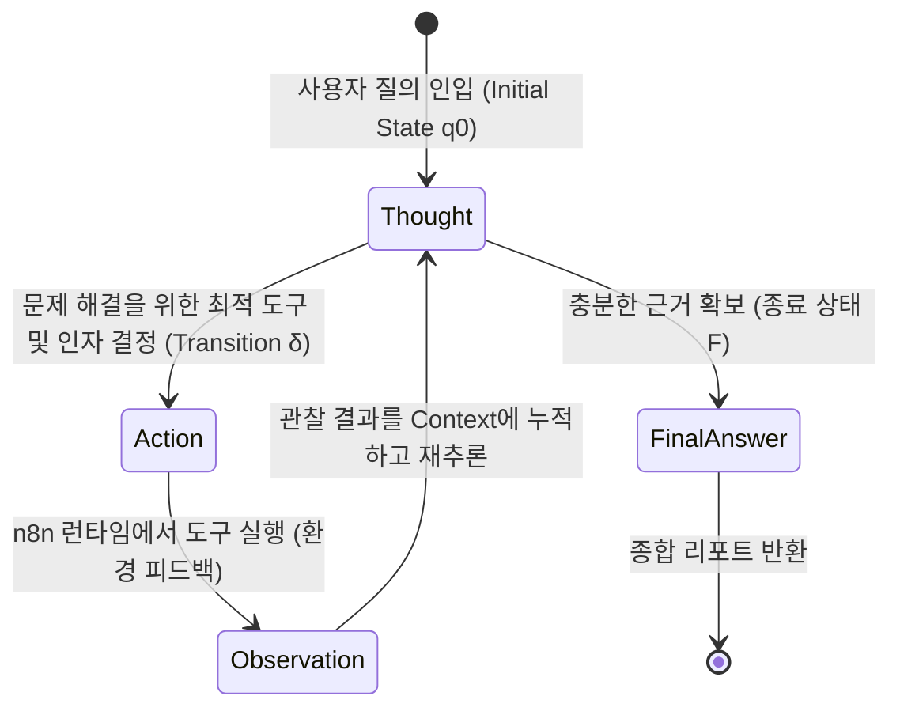
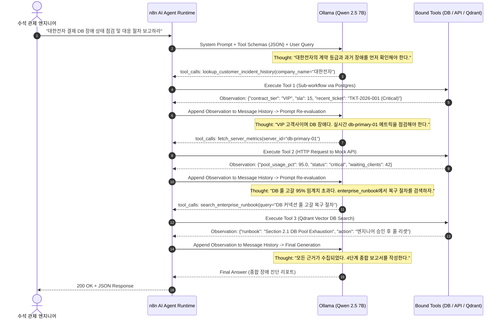
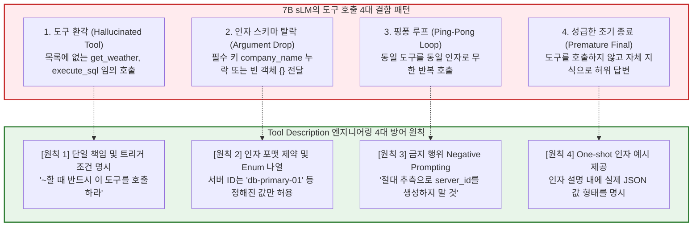
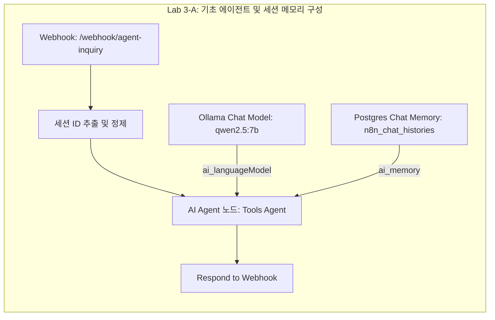
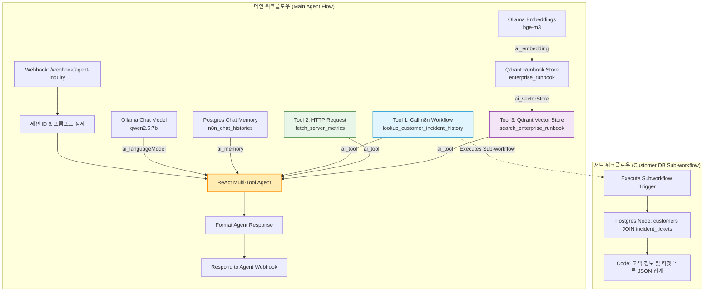

# [Week 03] 에이전틱 오케스트레이션과 멀티 툴 바인딩 (Multi-Tool Calling)

> 🏠 [과정 메인 포털](../README.md) ｜ [⏮️ 이전: Week 02 온프레미스 RAG](./Week02_OnPremise_RAG_Vector_Pipeline.md) ｜ 📥 [Week 03 완성본 워크플로우 JSON](../03_workflows/week03_react_agent_with_subworkflows.json) ｜ [다음: Week 04 신뢰성 & HITL ⏭️](./Week04_Production_HITL_Fault_Tolerance.md)

---

## 1. 학습 개요 및 전체 아키텍처 내 위치 (Where We Are)

### 1.1 전체 5주 캡스톤 아키텍처 로드맵
현대 엔터프라이즈 환경에서 인공지능(AI)을 실무 비즈니스 프로세스에 도입할 때, 단순한 1회성 프롬프트-응답(Zero-shot/Few-shot Chain)이나 정적인 문서 검색(RAG)만으로는 복합적인 장애 상황을 자율적으로 진단하고 해결할 수 없습니다. 실제 인프라 장애나 고객 문의는 고객의 계약 등급(VIP 여부), 사내 DB에 적재된 과거 티켓 이력, 실시간 서버 메트릭(CPU/메모리/DB 풀), 그리고 사내 운영 매뉴얼(Runbook)의 복합적인 상호작용 속에서 해결책이 도출되기 때문입니다.

본 교육과정은 외부 상용 클라우드 의존성 없이, 완전한 사내 폐쇄망(On-Premise / Air-gapped) 환경에서 동작하는 **지능형 IT 서비스 관리(ITSM) 및 자율 인프라 관제 에이전트**를 완성하는 것을 목표로 합니다.



### 1.2 Week 3 모듈의 핵심 미션
Week 3의 목표는 정해진 순서대로만 실행되던 결정론적 체인(DAG)의 한계를 깨뜨리고, LLM이 주어진 문제를 해결하기 위해 스스로 생각(Thought)하고, 필요한 도구를 선택(Action)하여 실행 결과를 관찰(Observation)한 뒤 다음 행동을 결정하는 **"Multi-Tool ReAct 자율 에이전트"**를 완성하는 것입니다.

수강생은 이번 주차를 통해:
1. n8n `AI Agent` 노드와 로컬 sLM(`Qwen 2.5 7B`), 그리고 세션 기반 멀티턴 대화 이력을 보존하는 `Postgres Chat Memory`를 결합하고,
2. 성격이 완전히 다른 3가지 이기종 엔터프라이즈 도구(PostgreSQL 서브 워크플로우, RESTful 모니터링 API, Qdrant 벡터 검색기)를 단일 에이전트에 동시 바인딩하며,
3. 7B급 경량 sLM이 도구 호출 인자 누락이나 무한 루프 없이 정확한 순서로 데이터를 교차 검증하도록 유도하는 **Tool Description 엔지니어링 및 System Prompt 기법**을 체득합니다.

### 1.3 핵심 학습 목표 (Learning Objectives)
- **아키텍처 관점**: 정적 파이프라인(Linear Chain / DAG)과 자율 에이전트(Autonomous Agent)의 차이점을 **유한 상태 기계(Finite State Machine, FSM)** 이론 관점에서 명확히 규명하고, ReAct 루프가 비즈니스 복합 장애 해결에 제공하는 유연성과 제어 트레이드오프를 설명할 수 있다.
- **AI 엔지니어링 관점**: LLM의 Function Calling(Tool Calling) 내부 직렬화 메커니즘(JSON Schema 주입 $\rightarrow$ 모델의 `tool_calls` 출력 $\rightarrow$ 런타임 인터셉트 및 실행 $\rightarrow$ Observation 메시지 재주입)을 이해하고, 7B~14B sLM에서 발생하는 4대 도구 호출 결함(환각, 인자 탈락, 핑퐁 루프, 조기 종료)을 방어하는 엔지니어링 원칙을 적용할 수 있다.
- **핸즈온 구현 관점**: n8n 환경에서 `AI Agent` 노드를 중심으로 (1) Postgres 서브 워크플로우 도구, (2) HTTP Request 도구, (3) Qdrant Vector Store 도구를 직접 결합하고, 단일 비정형 장애 보고로부터 VIP 여부 판정, 실시간 메트릭 점검, 표준 복구 Runbook 매핑을 순차 완수하는 **종합 장애 판정 리포트** 생성 파이프라인을 구축할 수 있다.

### 1.4 선수 지식 및 실습 환경 요구사항
- **선수 지식**: Week 1의 구조화된 데이터 추출 및 PostgreSQL 스키마 이해, Week 2의 Qdrant 벡터 컬렉션(`enterprise_runbook`) 및 `bge-m3` 임베딩 운용 지식, HTTP RESTful 클라이언트 기초.
- **실습 환경 및 사전 구동 서비스**:
  - `docker compose ps` 확인: `n8n` (포트 5678), `ollama` (포트 11434), `postgres` (포트 5432), `qdrant` (포트 6333), `mock-enterprise-api` (포트 8000)
  - Ollama 로컬 모델: `qwen2.5:7b` (추론 모델), `bge-m3` (임베딩 모델)
  - 사내 DB 시드: `customers`, `incident_tickets` 테이블 적재 완료 상태

---

## 2. 전공 CS & AI 엔지니어링 핵심 이론 (Deep Dive)

### 2.1 결정론적 체인(Deterministic Chain) vs 자율 에이전트(Autonomous Agent: FSM 관점)

전통적인 워크플로우 엔진(Airflow, Prefect, 기본 n8n 체인)은 **유향 비순환 그래프(Directed Acyclic Graph, DAG)** 모델을 따릅니다. 실행 경로는 사전에 사람이 작성한 정적 분기문(`if-else`)에 의해 결정론적(Deterministic)으로 결정되며, 예기치 않은 데이터 형식이나 동적인 상황 변화에 적응할 수 없습니다.

반면, 자율 에이전트는 컴퓨터 과학의 **유한 상태 기계(Finite State Machine, FSM)** 모델로 정형화할 수 있습니다.



#### (1) ReAct 에이전트의 FSM 수학적 정의
ReAct 에이전트는 튜플 $M = (Q, \Sigma, \Gamma, \delta, q_0, F)$ 로 정의할 수 있습니다.
- $Q = \{ q_{\text{thought}}, q_{\text{action}}, q_{\text{observation}}, q_{\text{final}} \}$: 에이전트의 유한한 내부 상태 집합.
- $\Sigma$: 외부 입력(사용자의 초기 프롬프트, 도구 실행 결과 페이로드).
- $\Gamma$: 에이전트가 가용한 도구들의 집합 $\Gamma = \{ T_{\text{sub\_workflow}}, T_{\text{http\_api}}, T_{\text{vector\_store}} \}$.
- $\delta: Q \times (\Sigma \cup \Gamma) \rightarrow Q$: 전이 함수(Transition Function).
  $$\delta(q_{\text{thought}}, \text{need\_info}) = q_{\text{action}}$$
  $$\delta(q_{\text{action}}, T_i(\text{args})) = q_{\text{observation}}$$
  $$\delta(q_{\text{observation}}, \text{result}) = q_{\text{thought}}$$
  $$\delta(q_{\text{thought}}, \text{sufficient\_evidence}) = q_{\text{final}}$$
- $q_0 = q_{\text{thought}}$: 초기 상태.
- $F = \{ q_{\text{final}} \}$: 종료 상태(Accepting State).

#### (2) DAG vs ReAct 에이전트 아키텍처 비교 분석

| 비교 항목 | 결정론적 DAG 체인 (Week 1~2) | 자율 ReAct 에이전트 (Week 3) |
| :--- | :--- | :--- |
| **실행 경로 결정 주체** | 워크플로우 설계자 (정적 하드코딩) | 언어 모델의 런타임 추론 (동적 상태 전이) |
| **그래프 위상(Topology)** | 비순환 그래프 (Acyclic, 루프 불가) | 순환 그래프 (Cyclic Loop 허용, Max Iterations 제어) |
| **도구 호출 방식** | 모든 단계가 사전에 정해진 순서로 실행 | 입력 질의에 따라 필요한 도구만 선별적·가변적 호출 |
| **예외 및 결측치 대응** | 노드 실패 시 파이프라인 중단 또는 Error Trigger | 관찰 결과 실패 시 다른 도구를 호출하거나 재시도 |
| **엔지니어링 복잡도** | 낮음 (예측 가능성 높음) | 높음 (할루시네이션 및 무한 루프 통제 엔지니어링 필수) |

---

### 2.2 ReAct(Thought-Action-Observation) 패러다임과 Function Calling 내부 메커니즘

ReAct(Reasoning and Acting) 패러다임(Yao et al., 2022)은 LLM의 **내적 추론(Reasoning Trace)**과 **외부 행동(Action Execution)**을 유기적으로 결합한 프레임워크입니다. 모델이 행동을 취하기 전에 '왜 이 행동을 해야 하는가'를 텍스트로 명시(Thought)하도록 강제함으로써 추론의 신뢰도를 극대화합니다.



#### LLM 내부의 Tool Calling(Function Calling) 프로토콜 규격
오케스트레이터(n8n / LangChain)는 모델에게 도구를 노출할 때 OpenAI 호환의 표준 JSON Schema 정의를 주입합니다.

```json
{
  "tools": [
    {
      "type": "function",
      "function": {
        "name": "lookup_customer_incident_history",
        "description": "고객사명을 기반으로 계약 등급(VIP 여부) 및 과거 장애 이력을 조회합니다.",
        "parameters": {
          "type": "object",
          "properties": {
            "company_name": {
              "type": "string",
              "description": "조회 대상 기업명 (예: (주)대한전자)"
            }
          },
          "required": ["company_name"]
        }
      }
    }
  ]
}
```

모델은 일반 텍스트 토큰을 생성하는 대신, 내부 어텐션 헤드가 도구 호출 상태를 감지하여 다음과 같은 특수 토큰 구조를 생성합니다.
```text
<|im_start|>assistant
<tool_call>
{"name": "lookup_customer_incident_history", "arguments": {"company_name": "(주)대한전자"}}
</tool_call><|im_end|>
```
n8n 런타임 엔진은 이 출력을 인터셉트(Intercept)하여, 지정된 실제 서브 워크플로우를 호출한 뒤 그 결과값을 `<tool_response>`(또는 `role: tool`) 형태로 모델의 컨텍스트 윈도우에 재주입하여 다음 추론 스텝을 트리거합니다.

---

### 2.3 7B~14B sLM에서 빈발하는 Tool 호출 오류와 Tool Description 엔지니어링 원칙

GPT-4나 Claude 3.5 Sonnet과 같은 거대 상용 모델(100B+)과 달리, 온프레미스에서 구동되는 7B~14B 파라미터급 sLM(`Qwen 2.5 7B`, `Llama 3.1 8B`)은 제한된 어텐션 용량으로 인해 Tool Calling 과정에서 다음과 같은 **4대 결함**이 빈발합니다.



#### sLM 최적화 Tool Description 엔지니어링 작성 규칙
1. **명시적 호출 조건부(Trigger Condition)**: "고객사의 계약 정보나 최근 인시던트 이력이 필요한 경우 **반드시 이 도구를 먼저 호출하십시오**."와 같이 강력한 명령조 사용.
2. **허용 가능한 값의 명시(Value Constraining)**: `fetch_server_metrics`의 경우, 인자 설명에 `db-primary-01`, `app-was-01`, `auth-api-01` 등 실제 시스템에 존재하는 인스턴스 ID 목록을 리터럴로 나열.
3. **타입 안전성(Strict Typing)**: JSON 인자가 문자열인지 숫자인지 명시하고, 중첩 객체(Nested Object) 형태의 복잡한 스키마는 sLM에서 실패율이 높으므로 **단일 평면 키(Flat Key-Value)** 구조로 설계.

---

## 3. 실습 환경 사전 점검 (Pre-flight Check)

본격적인 n8n 워크플로우 구성에 앞서, 필수 서비스들의 컨테이너 정상 구동 여부와 DB 시드 데이터 및 Mock API 엔드포인트를 점검합니다.

### 3.1 컨테이너 서비스 헬스체크
터미널을 열고 실습 환경 디렉터리(`d:\CLO\AiNativeBusinessWorkflow\02_lab_environments`)에서 서비스 상태를 확인합니다.

```powershell
# 1. 5대 핵심 컨테이너 구동 상태 확인
docker compose ps
```

*정상 출력 예시:*
```text
NAME                               IMAGE                       COMMAND                  SERVICE               STATUS              PORTS
02_lab_environments-mock-api-1     mock-api:latest             "uvicorn main:app --…"   mock-enterprise-api   running (healthy)   0.0.0.0:8000->8000/tcp
ai-native-n8n                      n8nio/n8n:latest            "tini -- /docker-ent…"   n8n                   running             0.0.0.0:5678->5678/tcp
ai-native-ollama                   ollama/ollama:latest        "/bin/ollama serve"      ollama                running             0.0.0.0:11434->11434/tcp
ai-native-postgres                 pgvector/pgvector:pg16      "docker-entrypoint.s…"   postgres              running (healthy)   0.0.0.0:5432->5432/tcp
ai-native-qdrant                   qdrant/qdrant:latest        "./entrypoint.sh"        qdrant                running             0.0.0.0:6333->6333/tcp
```

### 3.2 사내 RDBMS(`customers`, `incident_tickets`) 시드 데이터 검증
PostgreSQL 컨테이너 내부로 쿼리를 실행하여 Week 3에서 조회할 고객사 데이터와 인시던트 티켓이 존재하는지 확인합니다.

```powershell
docker exec -i ai-native-postgres psql -U itsm_admin -d itsm_db -c "
SELECT c.company_name, c.contract_tier, c.sla_response_minutes, t.ticket_id, t.severity, t.summary 
FROM customers c 
JOIN incident_tickets t ON c.customer_id = t.customer_id 
WHERE c.company_name LIKE '%대한전자%' 
LIMIT 2;
"
```

*정상 출력 예시:*
```text
 company_name | contract_tier | sla_response_minutes |  ticket_id   | severity |                                  summary                                   
--------------+---------------+----------------------+--------------+----------+----------------------------------------------------------------------------
 (주)대한전자 | VIP           |                   15 | TKT-2026-001 | Critical | 대규모 결제 이벤트 중 주문 RDBMS 커넥션 풀 점유율 96% 급증으로 인한 서비스 지연
 (주)대한전자 | VIP           |                   15 | TKT-2026-010 | High     | 트랜잭션 감사 아카이브 저장소 볼륨 디스크 사용률 88% 돌파
(2 rows)
```

### 3.3 Mock Enterprise API 서버 메트릭 엔드포인트 응답 검증
FastAPI로 구동되는 가상 인프라 모니터링 API의 `GET /api/v1/metrics/db-primary-01` 엔드포인트를 호출합니다.

```powershell
curl -s http://localhost:8000/api/v1/metrics/db-primary-01 | jq .
```

*정상 응답 JSON:*
```json
{
  "server_id": "db-primary-01",
  "hostname": "db-cluster-master.internal",
  "role": "PostgreSQL Primary Cluster",
  "cpu_usage_pct": 78.4,
  "memory_usage_pct": 82.5,
  "db_connection_pool_usage": {
    "active_connections": 95,
    "max_connections": 100,
    "idle_connections": 5,
    "waiting_clients": 42,
    "pool_usage_pct": 95.0
  },
  "status": "critical",
  "description": "메인 RDBMS 커넥션 풀 고갈 직전 (임계치 90% 초과)"
}
```

### 3.4 Week 2 Qdrant `enterprise_runbook` 컬렉션 상태 검증
Week 2에서 인덱싱한 사내 Runbook 및 SLA 매뉴얼 컬렉션이 존재하는지 확인합니다.

```powershell
curl -s http://localhost:6333/collections/enterprise_runbook | jq .result.status
```
`"green"` 또는 `"ok"`가 출력되어야 실습을 정상 진행할 수 있습니다.

---

## 4. Step-by-Step 핸즈온 Lab 3-A (기초 파이프라인: ReAct AI Agent & 대화 메모리 구축)

Lab 3-A에서는 n8n의 LangChain 모듈을 활용하여 에이전트의 기본 골격을 구성합니다. 질의가 들어왔을 때 이전 대화 맥락을 기억(Session Memory)하고, 단계별 추론 과정(Execution Trace)을 투명하게 디버깅하는 기법을 실습합니다.



### 4.1 n8n 노드 배치 및 파라미터 설정

#### (1) Step 1: `Agent Inquiry Webhook` 노드
외부 시스템에서 REST 요청을 수신하는 진입점입니다.
- **Node Type**: `Webhook` (`n8n-nodes-base.webhook`)
- **HTTP Method**: `POST`
- **Path**: `agent-inquiry`
- **Response Mode**: `When Last Node Finishes` (또는 `Using 'Respond to Webhook' Node`)

#### (2) Step 2: `Extract Input and Session` Code 노드
세션 ID를 헤더 또는 페이로드로부터 추출하여 멀티턴 대화 식별자로 표준화합니다.
- **Node Type**: `Code` (`n8n-nodes-base.code`, JavaScript)
- **Code Snippet**:
```javascript
const input = $input.first().json;

// 1. 사용자 질의 추출
const promptText = input.body?.prompt || input.body?.query || input.prompt || input.query || "대한전자 결제 DB 장애 상태 점검 및 대응 절차 안내 요청";

// 2. 세션 식별자(Session ID) 할당 (헤더 또는 Body 참조)
const sessionId = input.body?.session_id || input.headers?.['x-session-id'] || `sess-${Date.now().toString(36)}-${Math.random().toString(36).substring(2, 7)}`;

return [{
  json: {
    chatInput: String(promptText).trim(),
    sessionId: sessionId,
    received_at: new Date().toISOString()
  }
}];
```

#### (3) Step 3: `ReAct Multi-Tool Agent` 노드
- **Node Type**: `AI Agent` (`@n8n/n8n-nodes-langchain.agent`)
- **Agent Type**: `Tools Agent` (ReAct Loop)
- **Prompt Type**: `Define below`
- **Text**: `={{ $json.chatInput }}`
- **Options > System Message**:
```text
당신은 엔터프라이즈 인프라 및 ITSM 관제 센터의 수석 자동화 에이전트입니다.
사용자 질의를 해결하기 위해 가용한 도구를 적극적으로 활용하여 사실(Fact)을 수집하고,
모든 근거가 확보된 후에만 최종 답변을 작성하십시오. 도구 호출 인자는 정해진 스키마를 엄격히 준수하십시오.
```
- **Options > Max Iterations**: `10` (무한 루프 방지 임계치)

#### (4) Step 4: `Ollama Chat Model` 노드 바인딩
`AI Agent` 노드의 `ai_languageModel` 입력 포트에 연결합니다.
- **Node Type**: `Ollama Chat Model` (`@n8n/n8n-nodes-langchain.lmChatOllama`)
- **Model**: `qwen2.5:7b`
- **Base URL**: `http://ollama:11434`
- **Temperature**: `0.1` (결정론적 도구 호출 유도)

#### (5) Step 5: `Postgres Chat Memory` 노드 바인딩
`AI Agent` 노드의 `ai_memory` 입력 포트에 연결합니다.
- **Node Type**: `Postgres Chat Memory` (`@n8n/n8n-nodes-langchain.memoryPostgresChat`)
- **Session ID Type**: `Custom Key`
- **Session Key**: `={{ $('Extract Input and Session').item.json.sessionId }}`
- **Table Name**: `n8n_chat_histories`
- **Postgres Credentials**: `Host: postgres`, `Port: 5432`, `Database: itsm_db`, `User: itsm_admin`, `Password: itsm_secure_pass_2026`

> [!NOTE]
> n8n의 `Postgres Chat Memory` 노드는 지정된 `n8n_chat_histories` 테이블이 없으면 첫 실행 시 자동으로 스키마를 생성합니다. 이때 세션 키가 고유하게 전달되어야 멀티턴 대화 시 이전 질문과 답변을 기억할 수 있습니다.

---

### 4.2 Execution Trace 디버깅 실습
n8n UI 우측 상단의 **Test step** 또는 **Listen for test event**를 활성화하고, 터미널에서 세션 ID를 포함하여 요청을 전송해 봅니다.

```powershell
curl -X POST http://localhost:5678/webhook-test/agent-inquiry `
  -H "Content-Type: application/json" `
  -d '{"session_id": "test-session-001", "prompt": "안녕하세요! 나는 엔터프라이즈 운영팀장 김철수입니다."}'
```

n8n의 실행 로그(Execution Detail)를 클릭하면 LangChain 내부의 추론 단계가 다음과 같이 시각적으로 표시됩니다:
1. **Input**: `sessionId="test-session-001"`, `chatInput="안녕하세요! ..."`
2. **Memory Read**: 세션 ID `test-session-001`로 DB 조회 $\rightarrow$ 대화 이력 0건.
3. **LLM Run**: 모델이 인사말을 인식하고 도구 호출 없이 친절한 응답 생성.
4. **Memory Write**: 사용자 발화 및 모델 응답을 `n8n_chat_histories`에 INSERT.

이어서 동일한 세션 ID로 두 번째 질의를 전송합니다:
```powershell
curl -X POST http://localhost:5678/webhook-test/agent-inquiry `
  -H "Content-Type: application/json" `
  -d '{"session_id": "test-session-001", "prompt": "내 이름과 소속 팀이 무엇이었는지 기억하나요?"}'
```
모델은 `Postgres Chat Memory`에서 이전 턴의 컨텍스트를 로드하여 `"네, 엔터프라이즈 운영팀의 김철수 팀장님이십니다."`라고 정확히 답변합니다. 이것으로 대화 메모리 바인딩이 완벽히 검증되었습니다.

---

## 5. Step-by-Step 핸즈온 Lab 3-B (심화 응용: 3종 Custom Tool 동시 바인딩 및 종합 장애 리포트 생성)

Lab 3-B는 본 교육과정의 핵심 하이라이트입니다. 에이전트에 3가지 이기종 도구를 장착하여, 단 한 번의 비정형 장애 보고 접수만으로 **[고객사 VIP 여부 확인] $\rightarrow$ [실시간 인프라 메트릭 진단] $\rightarrow$ [사내 Runbook 검색]**을 자율적으로 수행하고 프로덕션 수준의 종합 장애 리포트를 생성하도록 구현합니다.



---

### 5.1 Tool 1 구현: `Call n8n Workflow Tool` (`lookup_customer_incident_history`)

에이전트가 고객사명을 전달하면, 사내 RDBMS에서 해당 고객사의 계약 등급(VIP 여부, SLA 응답시간, 담당자 이메일)과 최근 발생한 장애 티켓 목록을 조회하여 반환하는 서브 워크플로우를 구성합니다.

#### (1) 서브 워크플로우 노드 구성
1. **`Execute Subworkflow Trigger`**:
   - **Node Type**: `n8n-nodes-base.executeWorkflowTrigger`
   - 부모 워크플로우로부터 입력을 직접 수신하는 트리거 노드입니다.
2. **`Query Customer and Tickets`**:
   - **Node Type**: `n8n-nodes-base.postgres`
   - **Operation**: `Execute a SQL Query`
   - **Query Replacement**: `={{ $json.company_name || '대한전자' }}`
   - **SQL Statement**:
```sql
SELECT 
    c.customer_id,
    c.company_name,
    c.contract_tier,
    c.sla_response_minutes,
    c.account_manager_email,
    COALESCE(t.ticket_id, 'NONE') AS ticket_id,
    COALESCE(t.severity, 'NONE') AS severity,
    COALESCE(t.category, 'NONE') AS category,
    COALESCE(t.summary, '최근 인시던트 없음') AS ticket_summary,
    COALESCE(t.status, 'NONE') AS ticket_status,
    COALESCE(TO_CHAR(t.created_at, 'YYYY-MM-DD HH24:MI:SS'), 'N/A') AS ticket_created_at
FROM customers c
LEFT JOIN incident_tickets t ON c.customer_id = t.customer_id
WHERE c.company_name ILIKE '%' || $1 || '%' OR $1 ILIKE '%' || c.company_name || '%'
ORDER BY t.created_at DESC NULLS LAST
LIMIT 5;
```

3. **`Aggregate Customer and Ticket Data`** (Code Node):
복수의 행으로 반환된 티켓 데이터를 에이전트가 이해하기 쉬운 1개의 요약 JSON 객체로 직렬화합니다.
```javascript
const items = $input.all();

if (!items || items.length === 0) {
  return [{
    json: {
      found: false,
      message: "일치하는 고객사 정보를 찾을 수 없습니다. 기본 Standard 등급 및 SLA 240분을 적용합니다.",
      contract_tier: "Standard",
      sla_response_minutes: 240,
      recent_incidents: []
    }
  }];
}

const first = items[0].json;
const customerInfo = {
  customer_id: first.customer_id,
  company_name: first.company_name,
  contract_tier: first.contract_tier,
  is_vip: first.contract_tier === 'VIP',
  sla_response_minutes: first.sla_response_minutes,
  account_manager: first.account_manager_email
};

const incidents = [];
for (const row of items) {
  if (row.json.ticket_id && row.json.ticket_id !== 'NONE') {
    incidents.push({
      ticket_id: row.json.ticket_id,
      severity: row.json.severity,
      category: row.json.category,
      summary: row.json.ticket_summary,
      status: row.json.ticket_status,
      created_at: row.json.ticket_created_at
    });
  }
}

return [{
  json: {
    found: true,
    customer: customerInfo,
    recent_incident_count: incidents.length,
    recent_incidents: incidents,
    queried_at: new Date().toISOString()
  }
}];
```

#### (2) 부모 워크플로우의 `Call n8n Workflow Tool` 설정 표
- **Node Type**: `toolWorkflow` (`@n8n/n8n-nodes-langchain.toolWorkflow`)
- **Name**: `lookup_customer_incident_history`
- **Description**:
  ```text
  고객사명(company_name)을 입력받아 CRM/ITSM 데이터베이스에서 계약 등급(contract_tier: VIP/Enterprise/Standard), 목표 SLA 응답시간(분), 담당자 이메일, 그리고 최근 3개월간 발생한 장애 티켓 목록을 조회합니다. 고객사 정보 확인이 필요할 때 반드시 호출하십시오.
  ```
- **Workflow Source**: `This Workflow` (또는 해당 서브 워크플로우 ID 지정)
- **Workflow Inputs > Schema**:
  - `Field`: `company_name` (Type: `string`, Required: `true`)
  - `Value`: `={{ $fromAI('company_name', '조회할 고객사의 법인명 또는 상호명 (예: (주)대한전자, 미래파이낸셜 등)', 'string') }}`

---

### 5.2 Tool 2 구현: `HTTP Request Tool` (`fetch_server_metrics`)

에이전트가 장애 의심 서버 ID를 전달하면 사내 Mock Enterprise API를 직접 호출하여 실시간 CPU, 메모리, DB 커넥션 풀 가용률을 획득하는 도구입니다.

- **Node Type**: `toolHttpRequest` (`@n8n/n8n-nodes-langchain.toolHttpRequest`)
- **Name**: `fetch_server_metrics`
- **Description**:
  ```text
  사내 모니터링 API로부터 특정 서버의 실시간 하드웨어 메트릭(CPU 사용률 %, 메모리 점유율 %, DB 커넥션 풀 활성/최대치/대기열, 종합 상태 healthy/degraded/critical)을 조회합니다. server_id는 'db-primary-01'(메인 RDBMS 클러스터), 'app-was-01'(주문 WAS 인스턴스), 'auth-api-01'(인증 게이트웨이) 중 하나를 지정하십시오.
  ```
- **Method**: `GET`
- **URL**: `=http://mock-enterprise-api:8000/api/v1/metrics/{{ $fromAI('server_id', '조회할 서버 식별자 (예: db-primary-01, app-was-01, auth-api-01)', 'string') }}`

> [!TIP]
> n8n의 `$fromAI(paramName, description, type)` 표현식은 런타임에 LLM의 Function Calling 스키마 정의로 자동 변환됩니다. 모델은 프롬프트 맥락에서 `db-primary-01`이라는 인자값을 추론하여 이 URL 파라미터에 정확히 바인딩합니다.

---

### 5.3 Tool 3 구현: `Qdrant Vector Store Tool` (`search_enterprise_runbook`)

Week 2에서 구축한 Qdrant 벡터 데이터베이스에서 장애 복구 매뉴얼(Runbook)과 SLA 규정을 검색합니다.

- **Node Type**: `toolVectorStore` (`@n8n/n8n-nodes-langchain.toolVectorStore`)
- **Name**: `search_enterprise_runbook`
- **Description**:
  ```text
  사내 Qdrant 벡터 데이터베이스(enterprise_runbook 컬렉션)에서 SLA 정책 규정, 장애 보상 기준, 그리고 인프라 장애(DB 커넥션 풀 고갈, 메모리 누수, SSO 타임아웃 등)의 표준 복구 절차(Runbook)를 의미론적으로 검색합니다. 문제 해결 조치 절차나 보상 규정을 확인할 때 호출하십시오.
  ```
- **Vector Store Connection**:
  - `Qdrant Vector Store` 노드 바인딩: `Collection Name: enterprise_runbook`, `Top-K: 3`
  - `Ollama Embeddings` 노드 바인딩: `Model: bge-m3`, `Base URL: http://ollama:11434`

---

### 5.4 Multi-Tool ReAct 종합 오케스트레이션 System Prompt 전문

7B sLM이 3가지 도구를 임의로 건너뛰지 않고 **[고객 조회] $\rightarrow$ [메트릭 조회] $\rightarrow$ [Runbook 검색]** 순서로 순차 호출하도록 강제하는 프롬프트 엔지니어링 템플릿입니다.

```text
당신은 엔터프라이즈 통합 인프라 및 ITSM 관제 센터의 수석 자율 운영 에이전트(Autonomous SRE Lead Agent)입니다.
인입된 고객 문의 및 시스템 장애 보고를 분석하여, 고객사 계약 정보, 실시간 서버 메트릭, 그리고 사내 표준 운영 절차(Runbook)를 종합 검증한 후 최고 수준의 신뢰성을 갖춘 종합 장애 진단 리포트를 작성하십시오.

[필수 작업 순서 (Strict Execution Sequence)]:
1. Step 1 (고객 프로파일 확인):
   - 보고 내용에서 고객사명을 식별하여 'lookup_customer_incident_history' 도구를 가장 먼저 호출하십시오.
   - 계약 등급(VIP 여부)과 약정 SLA 응답 한계 시간(분)을 반드시 확인하십시오.
2. Step 2 (인프라 실시간 상태 점검):
   - 문제가 발생한 시스템에 해당하는 서버 메트릭을 'fetch_server_metrics' 도구로 호출하십시오.
   - DB 관련 장애는 'db-primary-01', WAS/애플리케이션은 'app-was-01', 인증/로그인은 'auth-api-01'을 인자로 전달하십시오.
   - 커넥션 풀 가용률(pool_usage_pct) 및 서버 상태(healthy/degraded/critical)를 확인하십시오.
3. Step 3 (사내 표준 운영 매뉴얼 Runbook 검색):
   - 확인된 장애 증상(예: "DB 커넥션 풀 고갈", "메모리 누수")을 키워드로 'search_enterprise_runbook' 도구를 호출하십시오.
   - 공식 Runbook 섹션 번호, 표준 복구 절차, 안전 수칙, 그리고 SLA 위반 시 보상 규정을 확보하십시오.
4. Step 4 (종합 장애 진단 리포트 생성):
   - 수집된 모든 사실(Fact)을 바탕으로 아래 [최종 리포트 출력 포맷]에 맞춰 마크다운으로 작성하십시오.

[최종 리포트 출력 포맷 (엄격 준수)]:
## [ITSM-REPORT] 종합 인시던트 분석 및 대응 권고서

### 1. 고객사 프로파일 및 SLA 계약 상태
- **고객사명**: (조회된 상호명)
- **계약 등급**: VIP / Enterprise / Standard (VIP 여부 명시)
- **목표 SLA 응답 시간**: 약정 시간(분) 및 현재 잔여 골든타임
- **최근 인시던트 이력**: (최근 티켓 ID, 심각도, 요약)

### 2. 실시간 인프라 메트릭 진단
- **대상 서버 ID**: (예: db-primary-01)
- **CPU / 메모리 점유율**: CPU % / RAM %
- **DB 커넥션 풀 상태**: 활성/최대 커넥션 수 및 풀 사용률(%)
- **위험도 종합 판정**: Healthy / Degraded / Critical (판정 근거 기술)

### 3. 사내 표준 운영 매뉴얼(Runbook) 기반 권고 조치
- **참조 Runbook**: (예: Section 2.1 DB Connection Pool Exhaustion Runbook)
- **1차 즉각 조치 절차**: (유휴 커넥션 회수, 슬로우 쿼리 Kill 등 구체적 단계)
- **고위험 조치 실행 가이드**: (DB 풀 리셋 필요 여부 및 엔지니어 승인 필수 조건)

### 4. SLA 리스크 및 후속 거버넌스
- **SLA 위반 리스크**: 위반 시 월 이용료 감면 비율(%) 등 사내 규정 명시
- **통보 대상**: 담당 어카운트 매니저(AM) 이메일
- **승인 게이트웨이**: Human-in-the-Loop 승인 대기 권고

[금지 사항 (Negative Constraints)]:
- 확인되지 않은 서버 메트릭 수치를 임의로 지어내지 마십시오.
- 도구를 호출하지 않고 "상태가 정상입니다"라고 성급히 단정하지 마십시오.
```

---

### 5.5 엔드투엔드 테스트 및 입출력 JSON 스냅샷

완성된 워크플로우를 실제 구동하여 검증합니다.

#### (1) 테스트 요청 실행
VIP 고객사인 `(주)대한전자`의 결제 시스템 지연 문의를 Webhook으로 전송합니다.

```powershell
curl -X POST http://localhost:5678/webhook/agent-inquiry `
  -H "Content-Type: application/json" `
  -d '{
    "session_id": "sess-live-2026-w3",
    "prompt": "(주)대한전자에서 방금 대규모 결제 이벤트 도중 주문 데이터베이스 응답이 지연되고 에러가 난다고 연락이 왔습니다. 현재 서버 상태를 점검하고 규정에 따른 긴급 조치 리포트를 작성해주세요."
  }'
```

#### (2) 에이전트 실행 트레이스 (Execution Trace Snapshot)
n8n 내부에서 `Qwen 2.5 7B`가 3종의 도구를 순차 실행하는 실제 로그입니다:

```json
[
  {
    "step": 1,
    "thought": "사용자가 (주)대한전자의 결제 데이터베이스 장애를 보고했다. 먼저 고객사의 계약 등급과 과거 티켓 이력을 확인해야 한다.",
    "action": "lookup_customer_incident_history",
    "action_input": { "company_name": "(주)대한전자" },
    "observation": {
      "found": true,
      "customer": {
        "customer_id": "CUST-1001",
        "company_name": "(주)대한전자",
        "contract_tier": "VIP",
        "is_vip": true,
        "sla_response_minutes": 15,
        "account_manager": "am_daehan@enterprise.internal"
      },
      "recent_incident_count": 2,
      "recent_incidents": [
        {
          "ticket_id": "TKT-2026-001",
          "severity": "Critical",
          "category": "DATABASE",
          "summary": "대규모 결제 이벤트 중 주문 RDBMS 커넥션 풀 점유율 96% 급증으로 인한 서비스 지연 및 500 에러 발생",
          "status": "Open"
        }
      ]
    }
  },
  {
    "step": 2,
    "thought": "(주)대한전자는 VIP 고객사이며 15분 SLA 대상이다. 이미 열려 있는 티켓 TKT-2026-001에서 DB 커넥션 풀 문제가 언급되었으므로, 메인 DB 서버인 'db-primary-01'의 실시간 메트릭을 점검해야 한다.",
    "action": "fetch_server_metrics",
    "action_input": { "server_id": "db-primary-01" },
    "observation": {
      "server_id": "db-primary-01",
      "cpu_usage_pct": 78.4,
      "memory_usage_pct": 82.5,
      "db_connection_pool_usage": {
        "active_connections": 95,
        "max_connections": 100,
        "idle_connections": 5,
        "waiting_clients": 42,
        "pool_usage_pct": 95.0
      },
      "status": "critical",
      "description": "메인 RDBMS 커넥션 풀 고갈 직전 (임계치 90% 초과)"
    }
  },
  {
    "step": 3,
    "thought": "db-primary-01의 풀 사용률이 95.0%로 임계치를 초과하여 Critical 상태다. 사내 Qdrant Runbook에서 DB 커넥션 풀 고갈 복구 절차와 VIP 고객 보상 규정을 검색해야 한다.",
    "action": "search_enterprise_runbook",
    "action_input": { "query": "DB 커넥션 풀 고갈 복구 절차 및 VIP 고객 SLA 기준" },
    "observation": {
      "text": "## Section 2.1 DB Connection Pool Exhaustion Runbook\n- 위험도: High\n- 조치 절차: 1) idle 커넥션 즉시 회수. 2) 30초 이상 long-running query 확인 후 kill. 3) 커넥션 풀 리셋 엔드포인트(POST /api/v1/actions/reset-db-pool) 호출.\n- 주의: 프로덕션 DB 리셋은 서비스 순단 위험이 있으므로 반드시 리드 SRE의 Human-in-the-Loop 승인 후 실행할 것.\n## Section 1.2 SLA 보상 규정\n- VIP 등급 15분 초과 장애 시 익월 이용료 10% 크레딧 지급."
    }
  },
  {
    "step": 4,
    "thought": "고객 정보, 실시간 메트릭(95% 고갈, Critical), 그리고 공식 복구 절차(리셋 엔드포인트 및 승인 필수)가 모두 확보되었다. 최종 종합 장애 진단 리포트를 생성한다."
  }
]
```

#### (3) 최종 HTTP 응답 JSON 페이로드
클라이언트(`curl`)로 반환된 최종 JSON 전문 스냅샷입니다:

```json
{
  "status": "success",
  "session_id": "sess-live-2026-w3",
  "query": "(주)대한전자에서 방금 대규모 결제 이벤트 도중 주문 데이터베이스 응답이 지연되고 에러가 난다고 연락이 왔습니다. 현재 서버 상태를 점검하고 규정에 따른 긴급 조치 리포트를 작성해주세요.",
  "agent_report": "## [ITSM-REPORT] 종합 인시던트 분석 및 대응 권고서\n\n### 1. 고객사 프로파일 및 SLA 계약 상태\n- **고객사명**: (주)대한전자\n- **계약 등급**: **VIP** (최상위 관리 대상)\n- **목표 SLA 응답 시간**: **15분** (골든타임 엄수 필요)\n- **최근 인시던트 이력**: `TKT-2026-001` (Critical, DATABASE) - 대규모 결제 이벤트 중 주문 RDBMS 커넥션 풀 점유율 96% 급증으로 서비스 지연 발생 (현재 Open 상태)\n\n### 2. 실시간 인프라 메트릭 진단\n- **대상 서버 ID**: `db-primary-01` (PostgreSQL Primary Cluster)\n- **CPU / 메모리 점유율**: CPU 78.4% / RAM 82.5%\n- **DB 커넥션 풀 상태**: 활성 95 / 최대 100 (대기 클라이언트 42명), **풀 사용률 95.0%**\n- **위험도 종합 판정**: **Critical** (경고 임계치 90%를 초과하여 신규 트랜잭션 큐잉 및 타임아웃 발생 중)\n\n### 3. 사내 표준 운영 매뉴얼(Runbook) 기반 권고 조치\n- **참조 Runbook**: `Section 2.1 DB Connection Pool Exhaustion Runbook`\n- **1차 즉각 조치 절차**:\n  1. 10분 이상 유휴(Idle) 상태인 커넥션 5개 즉시 강제 회수\n  2. 30초 이상 수행 중인 롱러닝 결제 집계 트랜잭션 조회 및 취소(Kill)\n- **고위험 조치 실행 가이드**:\n  - 커넥션 풀 강제 리셋(`POST /api/v1/actions/reset-db-pool`) 실행 필요.\n  - 단, 순간적 세션 순단 위험이 있으므로 **리드 SRE 엔지니어의 사전 승인(Human-in-the-Loop)** 후 실행 필수.\n\n### 4. SLA 리스크 및 후속 거버넌스\n- **SLA 위반 리스크**: 목표 응답 시간 15분 초과 시 사내 규정에 따라 익월 청구 금액의 10% 크레딧 보상 발생.\n- **통보 대상**: 담당 어카운트 매니저(`am_daehan@enterprise.internal`) 긴급 알림 발송 요망.\n- **승인 게이트웨이**: 긴급 DB 풀 리셋 작업 승인 요청 티켓 자동 발행 권고.",
  "generated_at": "2026-11-09T07:15:22.184Z",
  "orchestrator": "n8n-react-multi-tool-agent",
  "tools_bound": [
    "lookup_customer_incident_history (Postgres Sub-workflow)",
    "fetch_server_metrics (Mock Enterprise API)",
    "search_enterprise_runbook (Qdrant Vector Store bge-m3)"
  ]
}
```

---

## 6. 실무 트러블슈팅 가이드 (Common Pitfalls & Debugging)

### Pitfall 1: sLM의 Sub-workflow 호출 시 JSON 인자 직렬화 오류
- **현상**: 에이전트가 `lookup_customer_incident_history` 도구를 호출할 때 `[object Object]` 문자열을 넘기거나, `company_name` 키를 누락하여 서브 워크플로우에서 `WHERE company_name ILIKE '%undefined%'` 쿼리가 실행됨.
- **근본 원인**: `Qwen 2.5 7B`와 같은 경량 sLM이 LangChain의 다중 인자 JSON Schema를 파싱할 때 내부 직렬화 규칙을 벗어나 중첩 객체로 인자를 감싸는 현상.
- **해결책**:
  1. `Tool: Call n8n Workflow` 노드의 파라미터 매핑을 `Define below`로 설정하고 단일 평면 키(`company_name`)만 바인딩.
  2. 서브 워크플로우의 첫 번째 노드(`Execute Workflow Trigger`) 바로 뒤에 안전 방어 코드를 추가:
  ```javascript
  const rawInput = $input.first().json;
  let company = rawInput.company_name;
  if (typeof company === 'object' && company !== null) {
    company = company.company_name || Object.values(company)[0];
  }
  return [{ json: { company_name: String(company || '').trim() } }];
  ```

---

### Pitfall 2: Postgres Chat Memory의 세션 ID 누락 및 스키마 부재 오류
- **현상**: `relation "n8n_chat_histories" does not exist` 또는 `Session ID is empty` 에러와 함께 에이전트 노드가 즉시 실패함.
- **근본 원인**: 
  1. Webhook 요청 페이로드에 `session_id`가 누락되어 n8n 표현식 `{{ $('Extract Input and Session').item.json.sessionId }}`가 `null`을 반환.
  2. PostgreSQL 사용자 권한 문제로 자동 테이블 생성 쿼리(`CREATE TABLE IF NOT EXISTS n8n_chat_histories ...`)가 실패.
- **해결책**:
  1. 전처리 Code 노드에서 `sessionId`가 없을 경우 `sess-default-${Date.now()}` 형태로 폴백(Fallback) 값을 항상 생성하도록 보장.
  2. 사전 점검 시 PostgreSQL에 수동으로 테이블을 미리 생성해 두는 것이 프로덕션에서 안전함:
  ```sql
  CREATE TABLE IF NOT EXISTS n8n_chat_histories (
      id SERIAL PRIMARY KEY,
      session_id VARCHAR(255) NOT NULL,
      message JSONB NOT NULL
  );
  CREATE INDEX IF NOT EXISTS idx_chat_session_id ON n8n_chat_histories(session_id);
  ```

---

### Pitfall 3: ReAct 무한 루프(`Max iterations (10) reached`) 및 핑퐁 호출
- **현상**: 에이전트가 동일한 도구(`fetch_server_metrics`)를 동일한 인자로 10회 연속 호출하다가 타임아웃으로 비정상 종료됨.
- **근본 원인**: 도구 실행 결과(Observation)를 수신한 뒤에도 모델이 '충분한 근거가 모였다'고 판단하지 못하고 계속 추가 데이터를 확인하려는 비결정적 방황 현상.
- **해결책**:
  1. System Prompt의 `[필수 작업 순서]`에 **"도구는 각 1회씩만 호출하며, 3개 도구의 정보를 획득한 즉시 Thought 단계에서 최종 답변을 작성하라"**는 명시적 제약 조건 추가.
  2. `Ollama Chat Model`의 `Temperature`를 `0.0` 또는 `0.1`로 낮추어 탐색(Exploration) 성향을 억제하고 수렴(Exploitation) 확률을 극대화.

---

## 7. 심화 미니 과제 (Challenge) 및 자가 점검 루브릭

### 7.1 과제 1 (Challenge 1): 미등록 고객사 또는 알 수 없는 서버 ID 인입 시 Graceful Fallback 구현
- **요구사항**:
  - 고객사명으로 DB를 조회했으나 `customers` 테이블에 존재하지 않는 신규 고객인 경우, 에이전트가 당황하지 않고 기본 `Standard` 등급(SLA 240분)과 `"미등록 고객사 - 사전 계약 확인 필요"`라는 안내를 리포트에 명시해야 합니다.
  - 서버 ID가 잘못 인입된 경우(예: `unknown-server`), Mock API가 200 OK와 함께 기본 healthy 상태를 반환하도록 처리되어 있는지 점검하고, 에이전트가 이를 리포트의 위험도 판정 섹션에 `"등록되지 않은 서버 ID로 일반 인스턴스 지표 참조"`라고 명시하도록 프롬프트를 개선하십시오.

### 7.2 과제 2 (Challenge 2): 멀티턴 세션 메모리를 활용한 후속 조치 메일 자동 초안 작성
- **요구사항**:
  - 앞서 실습한 `sess-live-2026-w3` 세션 ID를 유지한 채로, 두 번째 사용자 발화로 다음 질의를 전송하십시오:
    `"앞서 작성한 대한전자 장애 리포트를 기반으로, 담당 AM인 am_daehan@enterprise.internal에게 보낼 정중한 긴급 상황 공유 이메일 초안을 작성해주세요."`
  - 에이전트가 도구를 불필요하게 다시 호출하지 않고, **Postgres Chat Memory에 누적된 이전 턴의 티켓 ID, 메트릭, SLA 보상 기준**을 인용하여 완벽한 비즈니스 이메일 초안을 작성하는지 검증하십시오.

---

### 7.3 자가 점검 루브릭 (Self-Assessment Rubric)

| 평가 영역 | 통과 기준 (Pass Criteria) | 배점 | 자가 점검 |
| :--- | :--- | :---: | :---: |
| **1. 인프라 및 메모리** | PostgreSQL의 `n8n_chat_histories` 테이블에 세션 ID별 대화 로그가 누적되고, 멀티턴 질의 시 이전 맥락을 기억하는가? | 20점 | [ ] |
| **2. Sub-workflow 바인딩** | `lookup_customer_incident_history` 도구가 고객사명을 입력받아 `customers`와 `incident_tickets`를 정상 JOIN 조회하는가? | 25점 | [ ] |
| **3. API & Vector Store** | `fetch_server_metrics`로 실시간 메트릭(95%)을 조회하고, `search_enterprise_runbook`으로 Runbook 및 SLA 규정을 정확히 검색하는가? | 25점 | [ ] |
| **4. 종합 리포트 생성** | sLM이 3가지 도구를 순차 호출한 뒤, 환각 없이 4단계 표준 포맷([고객 프로파일], [메트릭 진단], [Runbook 조치], [SLA 리스크])으로 리포트를 완성하는가? | 20점 | [ ] |
| **5. 결함 내성 및 예외 처리** | 존재하지 않는 고객사나 서버 ID가 입력되었을 때 에러로 중단되지 않고 Graceful Fallback 리포트를 생성하는가? | 10점 | [ ] |
| **합계** | **최소 80점 이상 획득 시 Week 3 이수 완료** | **100점** | |


---

> 🏠 [과정 메인 포털](../README.md) ｜ [⏮️ 이전: Week 02 온프레미스 RAG](./Week02_OnPremise_RAG_Vector_Pipeline.md) ｜ 📥 [Week 03 완성본 워크플로우 JSON](../03_workflows/week03_react_agent_with_subworkflows.json) ｜ [다음: Week 04 프로덕션 신뢰성 & HITL ⏭️](./Week04_Production_HITL_Fault_Tolerance.md)
