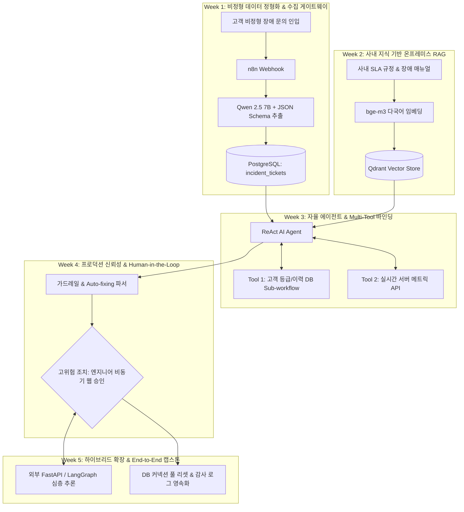

# AI Native Business Workflow: 온프레미스 sLM & n8n 에이전틱 오케스트레이션 (5주 자기주도학습 과정)

> **과정 형태**: 오픈소스 기반 자기주도 실습 코스웨어 (Self-Paced Hands-on Courseware)  
> **권장 학습 시간**: 주당 3시간 × 5주 (총 15시간)  
> **핵심 스택**: `n8n` (Self-hosted) · `Ollama` (`Qwen 2.5 7B`, `bge-m3`) · `PostgreSQL 16` (`pgvector`) · `Qdrant` · `FastAPI`  
> 🌐 **전용 웹북(Web Textbook) 바로가기**: [https://hdseon4k.github.io/ai-native-business-workflow/](https://hdseon4k.github.io/ai-native-business-workflow/)

---

## 1. 과정 소개 (Course Overview)

본 저장소는 외부 상용 클라우드(OpenAI 등)로의 데이터 반출이 엄격히 통제된 **엔터프라이즈 망분리(On-Premise / Air-gapped) 환경**을 전제로, 오픈소스 워크플로우 엔진 **n8n**과 로컬 소형 언어 모델(**sLM**)을 결합하여 프로덕션급 **지능형 IT 서비스 관리(ITSM) 및 비즈니스 운영 자동화 에이전트**를 밑바닥부터 직접 구축하는 5주 완성 자기주도학습 교재입니다.

### 전체 캡스톤 아키텍처 로드맵



---

## 2. 5주 자기주도학습 커리큘럼 바로가기 (Curriculum & Labs)

각 주차의 **상세 교안(이론 + Step-by-Step 실습)**을 순서대로 읽으며 직접 n8n 노드를 조립해 보세요. 실습 도중 막히거나 내 결과물과 비교하고 싶을 때는 우측의 **참조 워크플로우(JSON)**를 n8n에 `Import from File`로 불러와 확인할 수 있습니다.

| 주차 | 주제 및 핵심 학습 내용 | 상세 실습 교안 (웹 교재) | 참조 정답 워크플로우 (n8n JSON) |
| :---: | :--- | :---: | :---: |
| **Week 01** | **온프레미스 인프라 구축 & 비정형 데이터 정형화**<br>• RPA vs AI Native, sLM 양자화(GGUF)와 VRAM 산식<br>• Webhook 인입 텍스트의 JSON Schema 강제 추출 및 DB 적재 | [📘 Week 01 교안 보기](./01_manuscript/Week01_Infra_and_Structured_Output.md) | [📥 week01.json](./03_workflows/week01_structured_extraction.json) |
| **Week 02** | **온프레미스 RAG 파이프라인 & 사내 지식 베이스**<br>• Dense Retrieval, 코사인 유사도, `bge-m3` 다국어 임베딩<br>• 사내 SLA/장애 매뉴얼 청킹 및 `Qdrant` 기반 환각 방어 QA | [📘 Week 02 교안 보기](./01_manuscript/Week02_OnPremise_RAG_Vector_Pipeline.md) | [📥 week02.json](./03_workflows/week02_rag_indexing_and_query.json) |
| **Week 03** | **에이전틱 오케스트레이션 & 멀티 툴 바인딩**<br>• 유한 상태 기계(FSM), ReAct 루프, Function Calling 원리<br>• Sub-workflow(DB 조회) + 서버 메트릭 API + Qdrant 3종 도구 결합 | [📘 Week 03 교안 보기](./01_manuscript/Week03_Agentic_Orchestration_MultiTool.md) | [📥 week03.json](./03_workflows/week03_react_agent_with_subworkflows.json) |
| **Week 04** | **프로덕션 신뢰성 엔지니어링 & Human-in-the-Loop**<br>• 프롬프트 인젝션 가드레일, `Auto-fixing Output Parser`, 중앙 에러 로깅<br>• 고위험 조치 실행 전 `Wait` 노드 기반 비동기 인간 승인 게이트웨이 | [📘 Week 04 교안 보기](./01_manuscript/Week04_Production_HITL_Fault_Tolerance.md) | [📥 week04.json](./03_workflows/week04_hitl_approval_and_fallback.json) |
| **Week 05** | **하이브리드 아키텍처 확장 & End-to-End 캡스톤**<br>• n8n(시스템 I/O 백본) + FastAPI/LangGraph(심층 추론) 결합 및 Queue Mode<br>• 1~4주차 전체 통합 파이프라인 완성 및 4대 시나리오 자가 진단 | [📘 Week 05 교안 보기](./01_manuscript/Week05_Hybrid_Capstone_and_LLMOps.md) | [📥 week05.json](./03_workflows/week05_e2e_enterprise_capstone.json) |

---

## 3. 3분 실습 환경 구축 가이드 (Quickstart)

### 사전 준비물
- **Docker Desktop** (Windows WSL2 백엔드 또는 macOS Apple Silicon / Linux)
- **권장 사양**: RAM 16GB 이상, 여유 디스크 공간 15GB 이상 (GPU가 없어도 CPU/통합 메모리로 구동 가능)

### Step 1: 저장소 클론 및 환경변수 생성
```bash
git clone https://github.com/hdseon4k/ai-native-business-workflow.git
cd ai-native-business-workflow/02_lab_environments
cp .env.example .env
```

### Step 2: 올인원 컨테이너 스택 구동
```bash
docker compose up -d
```
구동되는 5개 핵심 서비스:
- `n8n` 워크플로우 캔버스: `http://localhost:5678`
- `ollama` 로컬 모델 서버: `http://localhost:11434`
- `postgres` (`pgvector` + 초기 ERP/장애 티켓 시드 DB): `localhost:5432`
- `qdrant` 벡터 데이터베이스 대시보드: `http://localhost:6333/dashboard`
- `mock-enterprise-api` 사내 모니터링/조치 모사 API 문서: `http://localhost:8000/docs`

### Step 3: 실습용 로컬 sLM 및 임베딩 모델 다운로드 (최초 1회)
```bash
# 추론 및 Tool Calling용 sLM (약 4.7GB)
docker exec -it ai-native-ollama ollama pull qwen2.5:7b

# 다국어/한국어 고성능 임베딩 모델 (약 1.2GB)
docker exec -it ai-native-ollama ollama pull bge-m3
```

> [!TIP]
> **macOS (Apple Silicon M1/M2/M3/M4) 사용자 팁**: Docker 내부의 Ollama 대신 macOS 네이티브 Ollama 앱을 설치하여 구동하면 Metal GPU 가속이 적용되어 추론 속도가 3~5배 빨라집니다. 이 경우 n8n의 Ollama Base URL 설정에 `http://host.docker.internal:11434`를 입력하십시오.

---

## 4. 자가 동작 검증 도구 (Self-Check CLI)

별도의 시험이나 과제 제출 없이, 5주차 캡스톤까지 본인이 구축한 파이프라인이 프로덕션 기준에 맞게 동작하는지 스스로 점검할 수 있도록 **자동 자가 진단 스크립트**를 제공합니다.

```bash
cd 02_lab_environments
python verify_capstone.py
```
- **자동 점검 시나리오 4종**:
  1. 일반(`Standard`) 고객 단순 문의 접수 및 정상 분류 확인
  2. `VIP` 고객 긴급 DB 커넥션 풀 고갈 장애 $\rightarrow$ HITL 비동기 승인 대기 및 승인 후 자동 리셋 확인
  3. 비정상/깨진 입력 데이터 인입 시 예외 방어 및 복구 확인
  4. 악의적인 프롬프트 인젝션(`Ignore previous instructions...`) 공격 차단 및 감사 로그(`audit_logs`) 기록 확인

---

## 5. 저장소 디렉터리 구조

```text
AiNativeBusinessWorkflow/
├── README.md                              # 수강생 자기주도학습 메인 포털 (본 문서)
├── mkdocs.yml                             # GitHub Pages 웹북(Web Textbook) 설정
├── 00_planning/                           # 교수자 과정 기획서 및 타당성 분석 아카이브
├── 01_manuscript/                         # Week 1 ~ Week 5 상세 이론 및 실습 교안 (Markdown)
├── 02_lab_environments/                   # Docker Compose, 시드 SQL, 사내 매뉴얼, Mock API, 자가 진단기
└── 03_workflows/                          # n8n에 즉시 Import 가능한 주차별 레퍼런스 워크플로우 JSON
```
